# rl_planner 결과 — RL 계획기 vs 상태기계 (2026-10-27 밤 실행)

> 설계·사용법은 [README.md](README.md). 이 문서는 무엇을 돌렸고 무엇이 나왔는지만 적는다.
> 숫자는 모두 이 PC(RTX 4060 Ti 8 GB, Ubuntu 26.04)에서 재현 가능 — 명령은 §9. 원자료는 `/data/runs/rl_planner/`.

## 요약

- **같은 장면 512개, 튜닝한 상태기계 대비 RL** (Isaac 학습 정책): 성공률 L3 99.6 → **100%**, L4 99.6 → **100%**,
  L5 91.8 → **99.8%** (Isaac 평가 90.4 → 99.8%), 완료 시간 **31~37% 단축** (12.1 → 8.3 s, 16.1 → 11.1 s, 16.9 → 10.6 s).
  L5 같은 장면 짝 비교 RL 만 성공 49 : 상태기계만 성공 1 (p < 1e-4).
- **학습에 없던 교란 6종** (코너 아웃라이어, 잡음 1.7배, 초점거리 3% 오차, VIO 자세 잡음, 강풍, 과중량)에서 RL 99~100% 유지,
  상태기계 60~99% (강풍 60.2%, 잡음 1.7배 85.9%). **검출 지연**도 L5 에서 0.5 s 까지 RL 99.4~100% (상태기계 91.8 → 78.3%).
- **약점 발견 → 보완**: 비행 중 3 s 카메라 끊김에서 RL 54% (상태기계 79%). 끊김 DR 로 19분 미세조정 → **88%**, 다른 성능 유지.
  검출이 전혀 안 되면 두 계획기 모두 100% 충돌 → **안전 필터로 0%**, 명목 성능 손실 0.
- **긴 끊김 (7 s)**: 끊김을 길게 학습하는 것만으로는 그대로였다 — 정책이 끊긴 시간을 관측하지 못해서다. 벽시계 **검출 공백 관측**을
  더해 긴 끊김으로 학습하자 +필터 3 s 94.5%, 7 s 75.0% (상태기계 + 필터 80.9 / 75.2%). 대신 강풍 99.2 → 95.1% (§5).
- **Isaac ↔ torch**: 한쪽에서 학습한 정책이 다른 쪽에서 같은 성능. Isaac 학습 2000 반복 1.5 h, 최고 난이도 도달 약 100 반복.
- **시드·설계 요소** (§7): 500 반복 학습 6개 중 5개가 L5 98.8~99.8% (본 정책 수준). 추정 개선 보상·커리큘럼·비대칭 비평가는
  최종 성능에 필수가 아니었다. 시드 하나는 초반 '제자리 비행' 국소해에 280 반복 갇혀 96.5% 에 그쳤다 → 시드 2~3개를 돌려
  검증 시드로 고르는 절차를 권장한다. 매 프레임 검출 시선 관측도 통과 정밀도에는 필요 없었다 (§4, §7).
- **이 문서의 모든 수치는 밤사이 고친 평가 버그 2건 이후의 것**이다: ① 계획기들이 서로 다른 장면에서 평가되던 짝맞춤 버그
  (이전 프로브 수치는 같은 분포의 다른 장면 비교) ② 안전 필터 설정을 정책 학습 시점 스냅샷에서 읽던 버그.
- **더 일반적인 상황 (§10)**: 교란 8 종을 새로 모델링하고 41 조건 평가 세트를 만들었다. 기존 정책의 약점(카메라 장착 오차 4° 에서
  30~37%, yaw ±55°, 긴 끊김, 범위 밖 바람, 복합 61~64%)을 세 곳에서 고쳤다: 삼각측량 망각 계수(재학습 없이 장착 오차 4° → 89~91%),
  안전 필터(긴 끊김에서 지나친 창문으로 끌려 돌아오던 정지 → 제동 정지점 + 감속, 7 s 끊김 70 → 94%), 넓은 DR 범용 정책.
  **범용 MLP + 필터**: 학습 범위 안 / 밖 / 처음 보는 교란 / 복합 평균 98.9 / 97.5 / 100 / 94.6% (상태기계 + 필터 91.4 / 69.3 /
  97.3 / 40.2%), 명목 시간 그대로. Isaac 에서도 같다.
- 배포 후보 (갱신, §10 끝): **범용 MLP 정책 + 안전 필터** (`planners/onboard.py`, 필터 기본값 = 검증 시드로 고른 설정).
  실기 전 남은 것: 실제 검출기·팀 PID·VIO 지연 (§8).
- **속도 (§11)**: 속도 상한은 행동 범위(1.28 m/s)였다. 기체 한계 2.0 m/s 로 넓혀 미세조정한 `speed_a` + 필터: 명목 L5 10.4 →
  **7.1 s** (팀 운용 한계 1.6 m/s 에서 8.2 s, −22%), 41 조건 평균 성공 98.9 → 97.1% (팀 한계에서 97.4 → 96.5%). 약해진 곳은 창문을
  지날 때의 조준 오차가 두 배인 탓이고 (추정기는 같다, 프레임만 적다), 보상·할인 조정으로는 바뀌지 않았다. 정확도를 겨냥한 3차
  (통과 여유 보상 ×3, 탐색 잡음 상한)는 지나는 자리를 17% 좁혔지만 강건성은 그대로라 **speed_a 를 유지**한다. 재학습 없이 제어기
  속도 상한만 1.6 m/s 로 낮추면 복합·끊김·바람 손실은 돌아온다 (속도 다이얼).
- **둘러보기 · 창문 50 개 (§12)**: 창문이 통과 직후 좌우 90°·위아래 1.2 m 꺾여 놓이는 코스에서 "방금 지난 창문에서 가장 가까운
  창문" 으로 간다. 범용 MLP 에 yaw 행동과 둘러보기 관측을 붙여 학습한 **scan_c2 + 필터** 가 창문 50 개 코스의 69.9% 를 끝까지 간다
  (창문당 99.3%, 약 135 s; 극한 배치 36.5%, 꺾인 코스 L4 93.8%). 학습 없는 둘러보기(상태기계)는 50 개에서 0%. 통과 직후 안 보이면
  좌우 50°·위아래 0.3 m 가량 훑어 0.7 s 안에 찾는다. 약점은 바람·카메라 장착 오차·계속 흔드는 고개. "다 훑은 뒤 고르기" 규칙
  (스캔 게이트)은 순서 위반을 거의 없앴지만 충돌이 늘어 (완주 31%) 실험 단계다. Isaac PhysX 에서도 같은 결과.
- **실제 기체 FX450 (§13)**: 판정을 지름 0.6 m 공에서 실제 FX450 모양(휠베이스 450 mm X, 10 인치 프롭, 몸체·짐 상자; DJI F450
  공식 스펙과 팀 SDF·CAD 대조)으로 바꿨다. 일자 코스 정책은 그대로 (41 조건 98.9%). 둘러보기 scan_c2 는 창문 50 개에서 70 → 52% 로
  떨어졌고, 실제 기체 판정으로 이어 학습한 **scan_fx + 필터가 78%** 로 되찾았다 (25 조건 평균 55.3%: 공 판정 scan_c2 50.7% 보다도
  높다) → 둘러보기 배포 후보 갱신. 대조 중 찾은 팀 쪽 불일치: Gazebo 월드 생성기의 모터 위치 (√2 이중 적용, 휠베이스 318 mm),
  모터 모델 최대 추력 = 호버 추력 (짐 1 kg), 이륙 중량 2.27 kg = F450 상한의 1.42 배.
- **줄에 매단 짐 + convex layer (§14)**: 짐 1 kg 을 0.4 m 줄로 매단 진자를 넣고, 신경망 뒤에 진자 동역학으로 1 s 앞을 예측해 흔들림·
  개구부 제약을 지키는 행동을 고르는 QP (convex layer; 모든 환경을 GPU 에서 한 번에 푸는 ADMM)를 붙였다. 일자 코스 41 조건:
  신경망만 0.5% → 재학습 없이 + layer 79.0% → layer 를 환경 안에 두고 줄 센서 관측을 더해 이어 학습한 **slung_a + layer 95.6%**
  (명목 L4 100%; 짐 없을 때 98.9%). Isaac PhysX 에서 같은 결과, 온보드 코드에도 같은 layer.

## 1. 무엇을 비교했나

- **RL**: rsl_rl PPO 정책 (actor 256-256-128, critic 512-256-128, 비대칭 — 비평가만 GT 사용). 10 Hz 로 웨이포인트 변위를 냄.
- **상태기계 (기준선)**: `backup/prototype_demo/traj_manager.py` + `window_flight.py --seq` 이식
  (`planners/fsm.py`). RL 과 **같은 행동 공간·같은 인지 추정치·같은 저수준 제어기**를 쓴다 (자기 위치는 잡음 없이 씀 — RL 에 불리한 쪽).
  파라미터는 검증용 시드(4242)에서 32개 조합 그리드 탐색으로 고른 최적값 — 평가 시드(12345)와 분리:
  `min_parallax 4°, sigma_thr 0.15 m, scan_amp 0.3 m, d_app 0.4 m, max_scan_rounds 2`.
  같은 평가 장면에서 기본값 대비: L4 98.2% · 19.3 s → 99.6% · 16.1 s, L5 77.7% · 20.9 s → 91.8% · 16.9 s
  (`/data/runs/rl_planner/eval_fsm_default`). 즉 RL 은 손으로 조정한 값이 아니라 튜닝된 기준선과 비교된다.
- **장면**: 평가마다 같은 시드의 512 장면. 계획기마다 난수를 다시 맞추고 리셋하므로 **두 계획기는 같은 장면·같은 카메라 잡음**에서
  난다 (장면 지문을 `summary.json` 에 기록, 어긋나면 평가 중단). 그래서 표에 같은 장면 짝 비교(RL 만 성공 / 상태기계만 성공 수,
  McNemar 정확 검정 p)를 함께 낸다. 같은 시드·레벨이면 torch 와 Isaac 백엔드도 같은 장면을 받는다.
- **레벨**: L3 창문 3개·실측 잡음(σ 2~9 px, 누락 ≤10%) / L4 창문 3~5개 + 창문 yaw ±20° /
  L5 스트레스: σ 4~12 px, 누락 5~20%, yaw ±30°, 간격 2.6~3.2 m.
- **백엔드**: Isaac Sim 6.2 + Isaac Lab 3.0 (PhysX) 와 순수 torch. 같은 MDP — 정책을 한쪽에서 학습해 다른 쪽에서 평가(교차).

지표: 성공률(전 창문을 순서대로 통과), 충돌률(벽·프레임 접촉/지면/이탈/전복/순서 위반), 완료 시간(성공 에피소드),
통과 여유(통과 지점에서 개구부 가장자리까지 여유 − 기체 반경 0.30 m; 가운데 통과 시 최대 ≈ 0.2 m),
통과 시 추정 오차(통과 순간 그 창문 중심 추정의 GT 오차), 시간 비(둘 다 성공한 장면에서 RL 시간 / 상태기계 시간의 평균).

## 2. 학습

| | Isaac (PhysX) | torch |
|---|---|---|
| 환경 × 반복 (반복당 48 결정) | 4096 × 2000 | 4096 × 1500 (seed 1) |
| 결정 스텝 | 3.9억 | 2.9억 |
| 벽시계 시간 · 처리량 | 1 h 31 m · 약 8.0만 결정/s | 52 m · 약 10.7만 결정/s (평가와 GPU 공유 구간 포함) |
| 커리큘럼 L5 도달 (평균 레벨 ≥ 4.9) | 102 반복 | 155 반복 |
| 마지막 50 반복 (L5, 확률적 정책) | 성공 99.87% · 충돌 0.13% · 10.5 s | 성공 99.76% · 충돌 0.24% · 10.4 s |

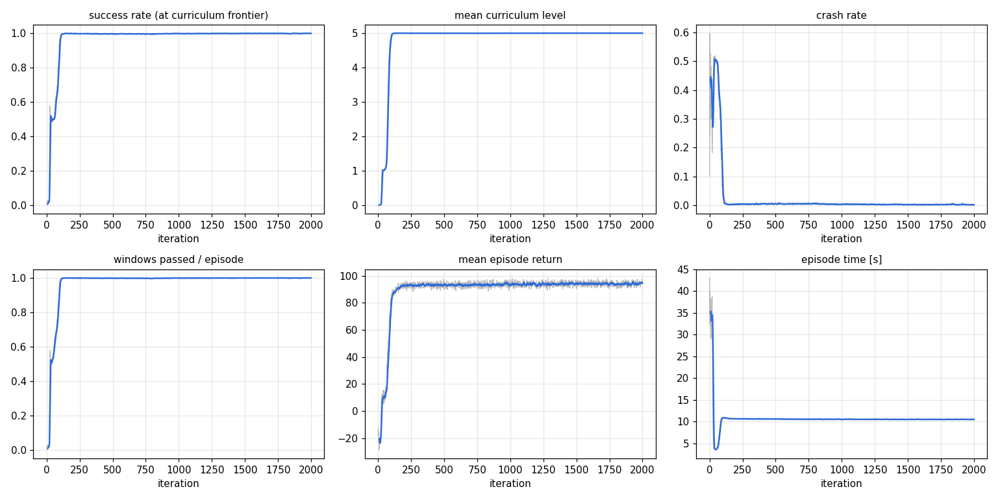

두 본 학습은 100~150 반복 안에 커리큘럼 최고 단계(L5)에 닿았고, 그 뒤는 L5 에서의 다듬기다. 학습 예산 자체는 병목이
아니다. §7 의 500 반복 학습 6개 중 5개가 본 정책과 같은 수준(L5 98.8~99.8%)에 도달했다. 다만 초반의 '제자리 비행' 국소해를
빠져나오는 시점이 학습마다 크게 달라서(L5 도달 101~470 반복) 학습 하나만 돌리면 늦어질 수 있다 (§7).

## 3. 명목 조건 — 같은 장면 512개

**Isaac(PhysX) 에서 학습한 정책** (각 칸: 상태기계 / RL)

| 조건 | 성공률 (상태기계 / RL) | 같은 장면: RL만 / 상태기계만 성공 | 시간 비 RL/상태기계 | 충돌률 | 완료 시간 [s] | 통과 여유 [m] | 통과 시 추정 오차 [m] |
|---|---|---|---|---|---|---|---|
| Isaac 평가, L3 | 99.6% / **100.0%** | 2 / 0 (p=0.5) | 0.69 | 0.4% / 0.0% | 12.1 / **8.3** | 0.182 / 0.195 | 0.039 / 0.032 |
| Isaac 평가, L4 | 99.2% / **100.0%** | 4 / 0 (p=0.12) | 0.70 | 0.8% / 0.0% | 16.0 / **11.1** | 0.175 / 0.194 | 0.041 / 0.038 |
| Isaac 평가, L5 | 90.4% / **99.8%** | 49 / 1 (p<1e-4) | 0.63 | 9.4% / 0.2% | 16.9 / **10.6** | 0.164 / 0.192 | 0.073 / 0.078 |
| torch 평가, L3 | 99.6% / **100.0%** | 2 / 0 (p=0.5) | 0.69 | 0.4% / 0.0% | 12.1 / **8.3** | 0.182 / 0.195 | 0.038 / 0.032 |
| torch 평가, L4 | 99.6% / **100.0%** | 2 / 0 (p=0.5) | 0.69 | 0.4% / 0.0% | 16.1 / **11.1** | 0.175 / 0.194 | 0.041 / 0.038 |
| torch 평가, L5 | 91.8% / **99.8%** | 42 / 1 (p<1e-4) | 0.63 | 8.2% / 0.2% | 16.9 / **10.6** | 0.165 / 0.192 | 0.073 / 0.078 |

**torch 에서 학습한 정책**

| 조건 | 성공률 (상태기계 / RL) | 같은 장면: RL만 / 상태기계만 성공 | 시간 비 RL/상태기계 | 충돌률 | 완료 시간 [s] | 통과 여유 [m] | 통과 시 추정 오차 [m] |
|---|---|---|---|---|---|---|---|
| Isaac 평가, L3 | 99.6% / **100.0%** | 2 / 0 (p=0.5) | 0.69 | 0.4% / 0.0% | 12.1 / **8.3** | 0.182 / 0.194 | 0.039 / 0.033 |
| Isaac 평가, L4 | 99.2% / **100.0%** | 4 / 0 (p=0.12) | 0.70 | 0.8% / 0.0% | 16.0 / **11.1** | 0.175 / 0.194 | 0.041 / 0.039 |
| Isaac 평가, L5 | 90.4% / **99.8%** | 48 / 0 (p<1e-4) | 0.63 | 9.4% / 0.2% | 16.9 / **10.6** | 0.164 / 0.192 | 0.073 / 0.079 |
| torch 평가, L3 | 99.6% / **100.0%** | 2 / 0 (p=0.5) | 0.69 | 0.4% / 0.0% | 12.1 / **8.3** | 0.182 / 0.194 | 0.038 / 0.033 |
| torch 평가, L4 | 99.6% / **100.0%** | 2 / 0 (p=0.5) | 0.69 | 0.4% / 0.0% | 16.1 / **11.1** | 0.175 / 0.194 | 0.041 / 0.039 |
| torch 평가, L5 | 91.8% / **99.8%** | 41 / 0 (p<1e-4) | 0.63 | 8.2% / 0.2% | 16.9 / **10.6** | 0.165 / 0.192 | 0.073 / 0.079 |

- **RL 이 같은 장면에서 30~37% 빨리 끝내면서 성공률도 같거나 높다** (시간 비 0.63~0.70). L5 에서 같은 장면 짝 비교
  RL 만 성공 49 / 상태기계만 성공 1 (McNemar p < 1e-4). L3·L4 에서는 둘 다 거의 100% 라 성공률 차이는 유의하지 않다.
- RL 은 개구부 가운데에 더 가깝게 지난다 (통과 여유 0.19 m, 최대 ≈ 0.2 m; 상태기계 0.16~0.18 m).
  통과 순간의 추정 오차는 비슷하다 — 빨리 날지만 덜 보고 통과하는 것은 아니다.
- **백엔드 교차**: Isaac 에서 학습한 정책을 torch 에서, torch 에서 학습한 정책을 Isaac 에서 평가해도 결과가 같다
  (L5 99.8% · 10.6 s). 두 정책(서로 다른 백엔드·시드)도 거의 같은 성능에 수렴했다. → 빠른 torch 백엔드로 반복 실험하고
  Isaac 으로 최종 확인하는 흐름이 성립한다. 상태기계는 L5 에서 Isaac 90.4% / torch 91.8% 로 조금 다르다 — 아슬아슬한
  통과가 많을수록 두 물리 엔진의 작은 차이가 결과를 가른다.
- 장면 512개 중 RL 실패는 L5 의 1건(벽 충돌)뿐이다.

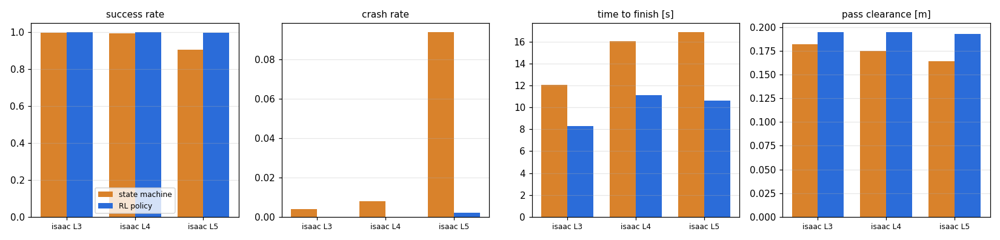

## 4. 학습에 없던 조건 (torch 평가, L4)

Isaac 본 정책, L4, 같은 장면 512개. 전체 표(torch 학습 정책 포함)는 [docs/tables_eval_main.md](docs/tables_eval_main.md).

| 조건 | 성공률 (상태기계 / RL) | 같은 장면: RL만 / 상태기계만 성공 | 시간 비 RL/상태기계 | 충돌률 | 완료 시간 [s] | 통과 여유 [m] | 통과 시 추정 오차 [m] |
|---|---|---|---|---|---|---|---|
| 기준 (명목 L4) | 99.6% / **100.0%** | 2 / 0 (p=0.5) | 0.69 | 0.4% / 0.0% | 16.1 / **11.1** | 0.175 / 0.194 | 0.041 / 0.038 |
| 코너 아웃라이어 3% | 94.7% / **100.0%** | 27 / 0 (p<1e-4) | 0.65 | 5.3% / 0.0% | 17.3 / **11.1** | 0.171 / 0.192 | 0.063 / 0.072 |
| 코너 잡음 ×1.7 | 85.9% / **99.8%** | 72 / 1 (p<1e-4) | 0.63 | 14.1% / 0.2% | 17.7 / **11.1** | 0.169 / 0.192 | 0.084 / 0.099 |
| 초점거리 보정 오차 3% | 97.9% / **100.0%** | 11 / 0 (p=0.00098) | 0.69 | 2.1% / 0.0% | 16.2 / **11.1** | 0.172 / 0.191 | 0.073 / 0.051 |
| VIO 자세 잡음 (3 cm, 0.5°) | 97.5% / **100.0%** | 13 / 0 (p=0.00024) | 0.60 | 2.5% / 0.0% | 18.5 / **11.1** | 0.171 / 0.189 | 0.065 / 0.068 |
| 강풍 0.6~1.0 m/s² | 60.2% / **99.0%** | 201 / 2 (p<1e-4) | 0.63 | 38.5% / 1.0% | 18.6 / **11.4** | 0.103 / 0.185 | 0.041 / 0.049 |
| 과중량 (질량 ×1.1~1.2, 추력 ×0.85~0.9) | 99.4% / **100.0%** | 3 / 0 (p=0.25) | 0.70 | 0.6% / 0.0% | 16.0 / **11.1** | 0.175 / 0.194 | 0.042 / 0.038 |
| 검출 지연 0.1 s | 98.6% / **100.0%** | 7 / 0 (p=0.016) | 0.69 | 1.4% / 0.0% | 16.3 / **11.3** | 0.175 / 0.194 | 0.040 / 0.037 |
| 검출 지연 0.2 s | 98.6% / **99.8%** | 7 / 1 (p=0.07) | 0.69 | 1.4% / 0.2% | 16.6 / **11.4** | 0.175 / 0.194 | 0.038 / 0.036 |
| 카메라 끊김 3~6 s | 78.9% / **54.1%** | 52 / 179 (p<1e-4) | 0.65 | 21.1% / 45.9% | 17.6 / **11.4** | 0.174 / 0.180 | 0.046 / 0.152 |
| 검출 전무 (성공 불가 — 충돌 여부만 의미) | 0.0% / **0.0%** | 0 / 0 (p=1) | – | 100.0% / 100.0% | – / **–** | 0.069 / – | 1.000 / – |

- 학습 분포 밖의 인지 교란(코너 아웃라이어, 잡음 1.7배, 초점거리 3% 오차, VIO 자세 잡음)과 과중량에서 **RL 은 99.8~100% 를
  유지**하고(완료 시간도 11.1 s 그대로), 상태기계는 85.9~97.9% 로 떨어진다.
- 상태기계 실패는 모두 벽·프레임 접촉이고 특정 창문에 몰리지 않는다. 잡음 1.7배에서 통과 시 추정 오차가 커지는데
  (상태기계 0.041 → 0.084 m, RL 0.038 → 0.099 m) RL 의 통과 여유는 0.192 m 그대로다. 통과 순간을 따로 재 보면 (Isaac 본 정책,
  잡음 1.7배, 통과 약 2000회):

  | | 추정 오차: 깊이(법선) 방향 | 추정 오차: 면내 | 실제 중심에서 벗어난 통과 위치 (평균 / 95%) | 좌우 통과 위치 ↔ 좌우 추정 오차 상관 |
  |---|---|---|---|---|
  | 상태기계 | 0.077 m | 0.022 m | 4.0 / 9.0 cm | 0.37 |
  | RL | 0.093 m | 0.029 m | **1.7 / 3.7 cm** | 0.08 |

  추정 오차는 대부분 깊이 방향이라 벽을 어디서 지나는지와 무관하다. 차이는 비행에서 난다. 상태기계는 면내 추정 오차보다 크게
  어긋나 지나가고, RL 은 그보다 작게 어긋난다. RL 의 좌우 통과 위치는 통과 순간 추정의 좌우 오차와 거의 상관이 없다. 즉 마지막
  추정을 그대로 따라가지 않는다. 처음에는 매 프레임 검출 시선(관측 `target_detection`)을 시각 서보처럼 쓴다고 추정했지만, 그 관측을
  빼고 학습한 정책도 같은 정밀도로 지나가서 이 가설은 기각했다 (§7). 무엇을 쓰는지는 아직 모른다
  (재는 스크립트: 아래 §9 `pass_geometry`).
- **강풍(0.6~1.0 m/s², 학습 최대 0.3)**: 상태기계 60.2% vs RL 99.0%. 저수준 Lee 위치 제어기는 비례 캐스케이드라 적분항이 없어
  일정한 바람에서 정상상태 오차 a_w/(k_p·k_v) ≈ 0.13~0.21 m 가 남는다. 상태기계는 고정 점(창문 중심)을 지령해 이 오차를
  안고 통과하고(통과 여유 0.103 m), RL 은 매 0.1 s 추정치를 보며 웨이포인트를 다시 내 사실상 적분처럼 보정한다(0.185 m).
  **적분항이 있는 저수준 제어기(성진 PID)에서는 이 격차가 줄 것**이므로, 이 행은 "RL 이 제어기 한계를 보완한다"로 읽어야 한다.
- **검출 지연** (`perception.latency_steps`): 찍은 프레임이 0.1~0.5 s 늦게 삼각측량·관측에 들어간다. 시선은 찍은 순간의
  자세로 계산한다(VIO 타임스탬프를 맞추는 실제 시스템과 같음). 두 계획기 모두 지연 없이 학습·튜닝했다. L4 에서는 0.2 s 까지
  영향이 작고(위 표: 상태기계 99.6 → 98.6%, RL 99.8~100%), 더 어려운 L5 에서 지연을 늘려 보면 차이가 벌어진다
  (Isaac 본 정책, 같은 장면 512개, 성공 / 충돌 %,
  `/data/runs/rl_planner/eval_latency`):

  | 검출 지연 (L5) | 상태기계 | RL | RL 완료 시간 [s] | 끊김 DR RL |
  |---|---|---|---|---|
  | 0 (명목) | 91.8 / 8.2 | 99.8 / 0.2 | 10.6 | 100.0 / 0.0 |
  | 0.1 s | 89.6 / 10.4 | 99.6 / 0.4 | 10.8 | 100.0 / 0.0 |
  | 0.2 s | 84.0 / 16.0 | 99.6 / 0.4 | 10.9 | 100.0 / 0.0 |
  | 0.3 s | 81.8 / 18.2 | 100.0 / 0.0 | 11.2 | 99.6 / 0.4 |
  | 0.5 s | 78.3 / 21.5 | 99.4 / 0.6 | 11.7 | 97.7 / 2.3 |

  상태기계는 지연이 커질수록 벽·프레임 충돌이 늘고(8.2 → 21.5%), RL 은 조금 느려질 뿐(10.6 → 11.7 s) 0.5 s 까지 성공률을
  유지한다. 안전 필터는 지연에서 거의 개입하지 않는다 (검출이 늦을 뿐 끊기지 않으므로; +필터를 함께 돌린 10개 조건 중
  한 장면만 달랐다 — 경계 이탈 1건이 필터에 막혀 시간 초과로). 자기 위치(VIO) 지연과
  지연 변동(지터)은 아직 모델링하지 않았다.
- **카메라 끊김에서는 RL 이 상태기계보다 약하다** (54.1% vs 78.9%) — §5.
- 검출 전무는 둘 다 100% 충돌 — §5.

## 5. 카메라가 못 볼 때 — 끊김 학습과 안전 필터

**발견.** 두 계획기 모두 학습·튜닝 때 "창문이 시야에 있는" 임무만 봤다. L4 512 장면에서 (Isaac 본 정책):

- **검출 전무** (검출기 고장 흉내, `configs/stress/blind.yaml`): 상태기계는 SEARCH 가 계속 전진해 첫 벽에 **100% 충돌**,
  RL 은 뒤·옆으로 물러나 경기장 경계를 **100% 이탈**.
- **비행 중 3 s 카메라 끊김** (3~6 s, `configs/stress/blackout.yaml`): RL 충돌 **45.9%** (상태기계 21.1%). RL 충돌은 대부분
  5~7 s, 창문 1~2개를 통과한 직후 다음 벽에서 났다 — 끊기기 전 몇 장으로 만든 다음 창문 추정을 믿고 진행한 것.

**대책 1 — 끊김을 겪으며 학습** (`domain_randomization.blackout_prob`). Isaac 본 정책에서 이어서 torch 로 500 반복(19분),
에피소드 절반에 0.5~4 s 카메라 끊김(시작 0.5~20 s). 평가에서는 끊김 DR 을 끈다(학습 전용 증강, `core/config.py`).
같은 장면에서 명목 L3/L4/L5 와 스트레스 6종은 본 정책과 같거나 낫고 (L5 99.8 → 100%, 잡음 1.7배 99.8 → 100%,
강풍 99.0 → 99.2% — 전체 표 [docs/tables_eval_main.md](docs/tables_eval_main.md)), **3 s 끊김 성공 54.1 → 87.7%**
(상태기계 78.9%, 같은 장면 짝 비교 92 : 47, p = 0.0002). 그러나 **학습보다 긴 7 s 끊김(3~10 s)에서는 6.1%** 다
(충돌 대부분 6~7 s, 창문 2개 통과 후 — 계속 날아갔다). 끊김을 길게 학습해도 그대로였던 이유는 이 절 끝에 있다.

**대책 2 — 실행 시 안전 필터** (`planners/safety.py` — 온보드 `OnboardPlanner` 에 기본 적용, 시뮬 평가는 계획기 이름 뒤 `+safe`):

1. 창문이 하나도 검출되지 않고 목표 창문을 "모르는"(유효한 추정이 없거나 σ > 0.3 m) 상태가 **시작 후 0.5 s / 첫 검출 이후 3 s**
   를 넘으면 그 자리에 정지 비행, 다시 검출되면 정책에 돌려준다.
2. 웨이포인트를 경기장 x/y 경계 0.5 m 안쪽으로 제한 (고도는 학습 때와 같은 제한).

임계값은 정상 비행을 멈추지 않도록, 개입 없이 비행시켜 잰 최장 "모름" 구간(`scripts/perception_gaps.py`)보다 길게 잡았다 —
RL 은 시작 직후 최대 0.3 s, 이후 최대 2.1 s (L5, σ 0.3 m 기준; 두 정책 모두). 정지 전환 시간과 σ 기준은 끊김 시험으로 골랐다
(끊김 DR 정책 + 필터, 성공 / 충돌 %):

| 필터 설정 | 명목 L5 | 3 s 끊김 | 7 s 끊김 |
|---|---|---|---|
| 필터 없음 | 100 / 0 | 87.7 / 12.3 | 6.1 / 93.9 |
| 정지 전환 2 s, σ 조건 없음 | 100 / 0 | 84.9 / 14.8 | – |
| 2.5 s, σ 0.3 m | 100 / 0 | 83.2 / 15.2 | 62.3 / 36.3 |
| **3 s, σ 0.3 m (기본값)** | 100 / 0 | **88.7 / 10.2** | **67.0 / 25.6** |
| 4 s, σ 조건 없음 | 100 / 0 | 87.7 / 12.1 | 22.7 / 72.3 |

설정은 평가 시드(12345) 장면에서 골랐으므로 **검증 시드(4242, 다른 512 장면)에서 다시 확인**했다 — 순위가 같다.
3 s / 7 s 끊김 성공률: 2 s·σ 없음 86.3 / 58.2%, 2.5 s·σ 0.3 m 83.6 / 64.6%, **3 s·σ 0.3 m 90.8 / 68.0%**, 4 s·σ 없음
87.9 / 24.4% (필터 없음 87.9 / 7.6%, 상태기계 79.9 / 61.3%; `/data/runs/rl_planner/eval_safety_sigma_val`).

σ 조건이 핵심이다: 추정이 "유효"하기만 하면 믿는 규칙(4 s, σ 없음)은 끊기기 전 몇 장으로 만든 부정확한 추정을 향해 날아가는 것을
막지 못한다. 정지가 너무 이르면(2~2.5 s) 정책이 스스로 하던 끊김 대처를 끊어 짧은 끊김에서 손해다.

개발 중 고친 것: 첫 버전(첫 검출 전 즉시 정지, 이후 1 s)은 명목 L5 RL 비행 1%를 교착(움직여야 창문이 보이는 자리에서
정지)시켰고, 둘째 버전은 고도 울타리가 학습 때보다 엄격해 명목 비행의 약 60%에서 1~2 스텝씩 개입했다. 또 평가·온보드가 안전
설정을 정책의 학습 시점 스냅샷에서 읽던 버그를 고쳤다(이제 항상 현재 설정). 최종 필터는 개입하지 않는 환경의 행동을 비트 단위로
그대로 통과시킨다.

**결과** (같은 장면 512개, 성공 / 충돌 %, `/data/runs/rl_planner/eval_safety_final`):

| 조건 (성공 / 충돌 %) | 상태기계 | 상태기계 +필터 | 본 RL | 본 RL +필터 | 끊김 DR RL | 끊김 DR RL +필터 |
|---|---|---|---|---|---|---|
| 명목 L4 | 99.6 / 0.4 | 100.0 / 0.0 | 100.0 / 0.0 | 100.0 / 0.0 | 100.0 / 0.0 | 100.0 / 0.0 |
| 명목 L5 | 91.8 / 8.2 | 92.6 / 6.6 | 99.8 / 0.2 | 99.8 / 0.2 | 100.0 / 0.0 | 100.0 / 0.0 |
| 카메라 끊김 3 s (3~6 s, L4) | 78.9 / 21.1 | 80.9 / 12.9 | 54.1 / 45.9 | 67.8 / 27.9 | 87.7 / 12.3 | 88.7 / 10.2 |
| 카메라 끊김 7 s (3~10 s, L4) | 56.8 / 43.2 | 75.2 / 17.0 | 1.8 / 98.2 | 56.2 / 35.5 | 6.1 / 93.9 | 67.0 / 25.6 |
| 검출 전무 (L4) | 0.0 / 100.0 | 0.0 / 0.0 | 0.0 / 100.0 | 0.0 / 0.0 | 0.0 / 100.0 | 0.0 / 0.0 |

- **명목 비행 손실 0** (L4·L5 모두 같은 장면에서 결과 동일). 상태기계는 필터가 시작 직후 창문을 못 본 채 전진하는 경우를 멈춰
  오히려 조금 좋아진다.
- **검출 전무: 충돌 100% → 0%** (모든 계획기). 임무는 못 하지만 제자리에서 버틴다 (실기라면 착륙·조종사 인계로 이어질 상태).
- **3 s 끊김은 끊김 DR RL + 필터가 가장 좋다** (88.7 / 10.2; 상태기계 + 필터 80.9 / 12.9).
- **7 s 끊김은 상태기계 + 필터가 가장 좋다** (75.2 / 17.0; 끊김 DR RL + 필터 67.0 / 25.6). 학습보다 긴 인지 상실에서 정책은
  여전히 너무 오래 날아간다.
- 긴 인지 상실까지 정책이 다루게 하려는 시도와 최종 배포 권장은 아래에 있다 ↓

**끊김을 더 길게 학습하면?** 같은 방식으로 끊김 길이만 0.5~10 s 로 늘려 Isaac 본 정책에서 500 반복 미세조정했다
(`robust_bo10`, 18분; 같은 장면 512개, 성공 / 충돌 %):

| 조건 (성공 / 충돌 %) | 끊김 DR ≤ 4 s | +필터 | 끊김 DR ≤ 10 s | +필터 |
|---|---|---|---|---|
| 명목 L5 | 100.0 / 0.0 | 100.0 / 0.0 | 100.0 / 0.0 | 100.0 / 0.0 |
| 카메라 끊김 3 s (3~6 s, L4) | 87.7 / 12.3 | 88.7 / 10.2 | 85.0 / 15.0 | 88.3 / 11.3 |
| 카메라 끊김 7 s (3~10 s, L4) | 6.1 / 93.9 | 67.0 / 25.6 | 6.2 / 93.8 | 69.5 / 26.2 |

**효과가 없었다.** 7 s 끊김에서 정책 단독은 6.2% 로 그대로다. 명목과 다른 스트레스는 같은 수준이다 (차이 ≤ 0.2%p,
[docs/tables_eval_main.md](docs/tables_eval_main.md)). 원인으로 보이는 것은 관측이다. 정책은 기억이 없는 MLP 인데, 카메라가 몇 초째
꺼져 있는지 알 길이 없다. `target_detection` 의 검출 경과는 찍힌 프레임 수로 세므로 프레임이 안 오면 멈추고, 삼각측량 추정도 그대로다.
그래서 끊긴 동안의 관측은 검출을 한 장 놓친 순간과 구별되지 않는다. 짧은 끊김에서는 계속 날아가는 편이 이득이므로, 긴 끊김을
섞어 학습해도 같은 행동이 나온다. → 끊긴 시간을 벽시계로 세는 관측(`detection_gap`)을 추가해 같은 조건으로 다시 미세조정했다 ↓

**검출 공백 관측 추가** (`detection_gap`): 마지막 검출 이후 경과 시간(아무 창문 / 목표 창문)을 벽시계로 세어 10 s 에서 포화시킨
관측이다. 실기에서는 마지막 검출 시각만 있으면 된다. 본 정책 model_1999 의 입력에 0 가중치로 붙이고(`scripts/expand_obs.py` —
붙인 직후에는 본 정책과 똑같이 행동한다), 긴 끊김 DR 과 같은 조건으로 500 반복 미세조정했다 (`robust_gap10`, 15분; 같은 장면 512개):

| 조건 (성공 / 충돌 %) | 끊김 DR ≤ 4 s | 긴 끊김 DR (≤ 10 s) | 검출 공백 관측 + 긴 끊김 DR |
|---|---|---|---|
| 명목 L5 | 100.0 / 0.0 | 100.0 / 0.0 | 99.8 / 0.2 |
| 강풍 (L4) | 99.2 / 0.8 | 99.0 / 1.0 | **95.1 / 4.9** |
| 카메라 끊김 3 s — 정책만 | 87.7 / 12.3 | 85.0 / 15.0 | **93.8 / 6.2** |
| 카메라 끊김 3 s — +필터 | 88.7 / 10.2 | 88.3 / 11.3 | **94.5 / 4.9** |
| 카메라 끊김 7 s — 정책만 | 6.1 / 93.9 | 6.2 / 93.8 | 12.3 / 87.7 |
| 카메라 끊김 7 s — +필터 | 67.0 / 25.6 | 69.5 / 26.2 | **75.0 / 21.5** |

(상태기계 + 필터: 3 s 끊김 80.9 / 12.9, 7 s 끊김 75.2 / 17.0)

- **끊김 대처가 좋아졌다.** 같은 장면 짝 비교로 3 s 끊김 +필터 94.5 vs 88.7% (40 : 10, p < 1e-4), 7 s +필터 75.0 vs 67.0%
  (72 : 31, p < 1e-4). 같은 긴 끊김 DR 에서 관측만 없는 정책과 비교해도 7 s +필터 75.0 vs 69.5% (59 : 31, p = 0.004) 라,
  효과는 DR 길이가 아니라 관측에서 왔다. 위 원인 진단과 맞는 결과다.
- 7 s 끊김에서 필터와 함께 **상태기계 + 필터와 성공률이 같아졌다** (75.0 vs 75.2%, 93 : 94). 충돌은 아직 더 많다
  (21.5 vs 17.0%). 정책 혼자서는 여전히 대부분 충돌하므로(12.3%) 긴 인지 상실은 지금도 안전 필터의 몫이다.
- **대가: 강풍에서 떨어졌다** (99.2 → 95.1%, 24 : 3, p < 1e-4). 바람은 학습 최대의 2~3배다. 실패 25건은 모두 벽 충돌이고 절반이
  첫 창문에서 났다. 같은 긴 끊김 DR 에 관측만 없는 정책은 99.0% 이므로 관측을 붙여 미세조정하면서 생긴 변화다. 원인은 아직
  모른다. 짧은 끊김 DR(≤ 4 s)에 같은 관측을 붙인 학습으로 가른다 ↓

**관측만 더하면?** 같은 관측을 붙이고 짧은 끊김 DR(≤ 4 s, 끊김 DR 정책과 같은 조건)로 미세조정한 `robust_gap4` 는 끊김 대처가
좋아지지 않았다. +필터 기준 3 s 끊김 86.9%, 7 s 66.2% 로 관측 없는 정책과 차이가 없다 (p ≥ 0.27). 강풍은 97.9% 다
(관측 없는 정책 99.2%, 2 : 9, p = 0.065). 네 정책을 한 표로 보면 (+필터, 성공 %; 강풍은 정책만):

| | 짧은 끊김 DR (≤ 4 s) | 긴 끊김 DR (≤ 10 s) |
|---|---|---|
| 검출 공백 관측 없음 | 3 s 88.7 · 7 s 67.0 · 강풍 99.2 | 3 s 88.3 · 7 s 69.5 · 강풍 99.0 |
| 검출 공백 관측 있음 | 3 s 86.9 · 7 s 66.2 · 강풍 97.9 | **3 s 94.5 · 7 s 75.0** · 강풍 95.1 |

끊긴 시간을 볼 수 있는 관측과 긴 끊김을 겪는 학습이 **둘 다** 있어야 효과가 난다. 짧은 끊김만 겪으면 계속 날아가는 것이 늘
답이라 관측을 쓸 이유가 없다. 관측이 없으면 긴 끊김을 겪어도 그것을 구별할 수 없다. 강풍 저하는 관측을 붙인 두 정책 모두에서
보이고, 긴 끊김 DR 과 함께일 때 크다. 원인은 아직 모른다 (강풍은 학습 최대의 2~3배라는 점도 감안).

**배포 권장 (갱신)** — §10 끝에서 범용 MLP + 개선한 필터로 다시 갱신했다.

- 기본: **끊김 DR 정책(`robust_bo`) + 안전 필터**. 본 정책보다 나빠진 조건이 없다 (강풍 99.2%, 3 s 끊김 88.7%). 단 7 s 끊김은
  67.0% 로 상태기계 + 필터(75.2%)보다 낮다.
- 카메라 프레임이 끊기는 일이 잦은 기체라면: **검출 공백 관측 + 긴 끊김 DR 정책(`robust_gap10`) + 안전 필터**.
  3 s 끊김 94.5%, 7 s 75.0% (상태기계 + 필터 80.9 / 75.2%), 명목 L5 99.8% 이다. 대신 강풍 95.1% 를 감수한다.
- 어느 쪽이든 실제 검출기·팀 PID 로 옮긴 뒤 같은 평가로 다시 고른다 (`scripts/evaluate.py`, 같은 장면 짝 비교).

## 6. 어디서 빨라졌나 — 비행 행동

512 장면 전체 궤적 (Isaac 본 정책 vs 튜닝 상태기계, torch 평가, `scripts/analyze_traj.py`, `/data/runs/rl_planner/eval_analysis`):

| | 상태기계 L4 | RL L4 | 상태기계 L5 | RL L5 |
|---|---|---|---|---|
| 평균 속도 [m/s] | 0.86 | **1.17** | 0.83 | **1.17** |
| 경로 길이 / 시작-끝 직선 거리 | 1.11 | **1.04** | 1.22 | **1.04** |
| 거의 정지(< 0.3 m/s)한 시간 비율 | 2% | 1% | 3% | 1% |
| 전진 1 m 당 좌우 이동 [m] | 0.32 | **0.13** | 0.46 | **0.14** |
| 전진 1 m 당 상하 이동 [m] | 0.10 | 0.11 | 0.11 | 0.11 |

- RL 은 멈춰서 스캔하지 않는다. 접근 경로의 완만한 곡선만으로 시차를 얻고(좌우 이동은 상태기계의 1/3), 통과 시 추정 오차는
  상태기계와 비슷하다(§3 표). README 의 가설("접근 비행 자체가 시차를 준다")을 정책이 스스로 찾은 셈이다.
- 상태기계의 시간 손실은 정지보다 스캔 우회(경로 11~22% 증가)와 낮은 평균 속도에서 온다. L5 에서 좌우 우회가 더 커진다(재스캔).

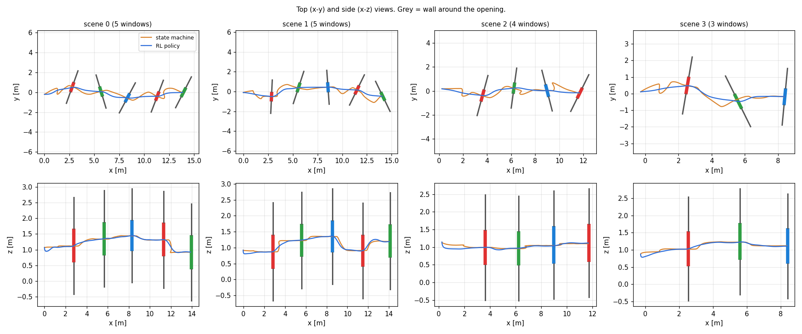

Isaac RTX 재생 (L5 같은 장면, 위: RL 10.2 s / 아래: 상태기계 17.2 s — 상태기계는 SEARCH → SCAN → APPROACH → TRAVERSE).
GIF 원본: `/data/runs/rl_planner/media/{rl,fsm}_L{3,5}_seed{5,7}.gif`

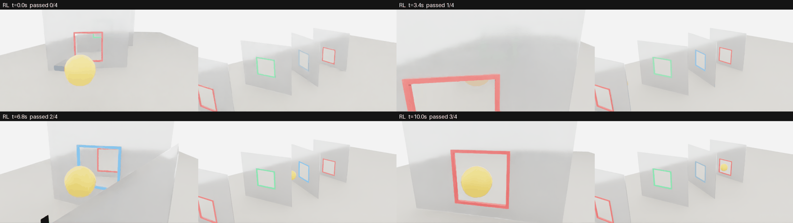
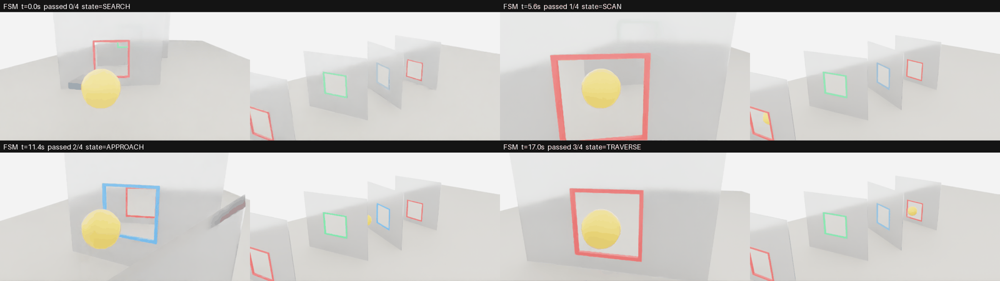

## 7. 시드 편차와 설계 요소 빼 보기

torch 백엔드에서 처음부터 500 반복씩(각 약 15분) 학습해 같은 평가 장면 512개에서 비교했다 (`/data/runs/rl_planner/eval_ablation`).
기본 설정으로 시드 3개, 그리고 설계 요소를 하나씩 뺀 학습 3개(시드 1): 추정 개선 보상 (`reward.estimate_improve=0`),
커리큘럼 (`curriculum.fixed_level=5` — 처음부터 L5), 비대칭 비평가 (`observation.critic=[]` — 비평가도 정책과 같은 관측만 봄).
나중에 매 프레임 검출 시선 관측 (`target_detection`) 을 뺀 학습 2개(시드 1, 2)를 더했다 (아래 마지막 항목).
제자리 비행 반복은 처음 500 반복 중 끝난 에피소드의 절반 넘게 시간 초과(성공도 충돌도 아님)였던 반복 수다.

| 학습 설정 (각 500 반복) | L5 도달 반복 | L5·학습 성공 95% 반복 | 제자리 비행 반복 (시간 초과 > 50%) | L4 성공 / 충돌 / 시간 [s] | L5 성공 / 충돌 / 시간 [s] |
|---|---|---|---|---|---|
| 전체 (시드 1) | 470 | 490 | 280 | 99.2% / 0.8% / 11.6 | 96.5% / 3.5% / 11.1 |
| 전체 (시드 2) | 101 | 107 | 29 | 100.0% / 0.0% / 11.1 | 99.8% / 0.2% / 10.6 |
| 전체 (시드 3) | 165 | 175 | 83 | 100.0% / 0.0% / 11.2 | 99.6% / 0.4% / 10.7 |
| 추정 개선 보상 없음 | 130 | 136 | 82 | 100.0% / 0.0% / 11.1 | 99.0% / 1.0% / 10.6 |
| 커리큘럼 없음 (L5 고정) | – | 217 | 185 | 99.8% / 0.2% / 11.2 | 98.8% / 1.2% / 10.6 |
| 대칭 비평가 (특권 정보 없음) | 290 | 299 | 159 | 99.2% / 0.8% / 11.2 | 99.8% / 0.2% / 10.7 |
| 검출 시선 관측 없음 (시드 1) | – | – | 415 | 0.0% / 97.7% / – | 0.0% / 97.5% / – |
| 검출 시선 관측 없음 (시드 2) | 218 | 241 | 115 | 100.0% / 0.0% / 11.3 | 100.0% / 0.0% / 10.9 |
| *참고: 본 Isaac 학습 (처음 500 반복)* | *102* | *104* | *18* | | |
| *참고: 본 torch 학습 (처음 500 반복)* | *155* | *167* | *51* | | |

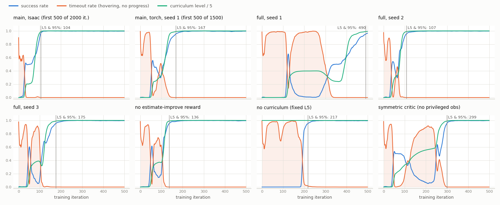

- **최종 성능은 빠진 설계 요소보다 국소해를 언제 빠져나왔는지로 갈렸다.** 300 반복 안에 L5 학습 성공 95% 에 닿은 5개는 L5 평가
  98.8~99.8% 로 같은 장면 짝 비교에서 서로 유의한 차이가 없고 (McNemar p ≥ 0.06), 2000 반복 본 정책(99.8% · 10.6 s)과 같은 수준이다.
  490 반복에야 닿은 시드 1 만 96.5% 로 나머지 다섯 모두보다 유의하게 낮다 (p ≤ 0.017).
- **설계 요소 3개는 최종 성능에 필수가 아니었다.** 추정 개선 보상 없이 99.0%, 커리큘럼 없이 98.8%, 대칭 비평가로 99.8%.
  각각 시드 1개라 1%p 안팎의 차이는 가릴 수 없지만, 어느 것을 빼도 학습이 무너지지 않았다. 기본값은 표준 구성대로 두고,
  단순화가 필요하면 빼도 된다는 근거로 읽는다. 커리큘럼 없이도 L5 를 바로 배웠다(217 반복). 커리큘럼이 있으면 보통 더 빨랐지만
  (기본 설정 5개 중 4개가 104~175 반복) 아래 정체를 막지는 못했다.
- **학습 정체 — 제자리 비행 국소해.** 모든 학습이 초반에 에피소드 대부분이 시간 초과로 끝나는 구간을 지난다. 정책이 창문에
  시도하지 않고 떠 있는 상태다. 서투른 시도는 충돌 벌점(−20)을 받고, 떠 있으면 스텝당 −0.02 만 받는다. 게다가 시간 제한은 실패가
  아니라 잘림으로 처리된다(rsl_rl 이 가치로 부트스트랩, Isaac Lab 표준). 그래서 실력이 붙기 전에는 떠 있는 편이 낫다. 이 구간의
  길이가 학습마다 크게 다르다. 본 학습 2개와 처음 6개를 합친 8개 중 5개는 18~83 반복에 끝났고, 3개(시드 1, 커리큘럼 없음,
  대칭 비평가)는 159~280 반복 걸렸다.
  시드 1 은 L2 에서 다시 갇혔고, 그동안 정책의 탐색 잡음(행동 표준편차)이 0.25 에서 0.08 로 줄었다. 본 torch 학습도 seed 1 이었지만
  평가 버그를 고치기 전 코드라 난수 흐름이 달랐고, 51 반복 만에 빠져나왔다. 정체 여부는 시드 번호만으로 정해지지 않는다.
- **실무 권장**: 학습 하나만 믿지 말고 시드 2~3개(torch 500 반복, 각 약 15분)를 돌려 검증 시드(4242) 평가로 고른다.
  정체를 줄이는 표준 대책은 아직 시험하지 않았다: 시간 초과도 커리큘럼 강등에 넣기, 충돌 벌점을 작게 시작해 키우기,
  탐색 잡음 하한 두기 (§8 다음 단계). 곡선 비교는 `scripts/compare_runs.py` 로 만든다.
- **검출 시선 관측 빼 보기** (`target_detection` 제거 — §4 의 '시각 서보' 가설 확인): 시드 1 은 L2 에서 제자리 비행에 갇혀
  500 반복 안에 수렴하지 못했다 (평가 0%). 시드 2 는 241 반복에 L5·학습 성공 95% 에 닿았다. 평가는 L4·L5 100%, 잡음 1.7배 100%.
  **같은 시드 2 의 기본 설정과 통과 정밀도가 같다.** 잡음 1.7배에서 실제 중심에서 벗어난 통과 위치가 평균 2.5 cm 대 2.5 cm,
  통과 여유가 0.186 대 0.187 m 다. 그러니 정밀도는 매 프레임 검출 시선에서 오지 않는다. 다만 두 시드 모두 같은 시드의 기본
  설정보다 늦게 배웠다 (시드 1: 500 반복 초과 대 490, 시드 2: 241 대 107 반복). 검출 시선은 삼각측량이 유효해지기 전부터 창문
  방향을 알려 주므로 학습 초반을 돕는 것으로 보인다 (시드 2쌍이라 시사 수준).

## 8. 해석, 한계, 다음 단계

### 해석

- **상태기계를 대체할 수 있다.** 같은 행동 공간·인지·제어기에서 RL 계획기는 튜닝한 상태기계보다 30~37% 빨리, 같거나 높은
  성공률로 임무를 끝낸다. 차이는 어려운 조건일수록 커진다 (L5, 검출 잡음, 바람, 검출 지연). 정책은 정지-스캔 없이 접근 경로에서
  시차를 얻고, 창문을 실제 중심에서 평균 1.7 cm 안으로 지나간다 (상태기계 4.0 cm, 잡음 1.7배 — 매 프레임 검출 시선 없이도 같음).
- **학습은 싸지만, 한 번만 돌리면 운이 섞인다.** 본 학습과 시드·설계 요소 학습 8개 중 7개가 300 반복(torch 약 9분) 안에
  L5·학습 성공 95% 에 닿았고, 하나는 제자리 비행 국소해에 갇혀 490 반복이 걸렸다. 추정 개선 보상·커리큘럼·비대칭 비평가는
  최종 성능에 필수가 아니었다 (§7).
  Isaac 과 torch 백엔드가 같은 성능으로 수렴하고 서로 바꿔 평가해도 같다 → 실험은 torch 로 빠르게(시드 여러 개), 확인은 Isaac 으로.
- **약점은 학습 분포 밖의 인지 상실이었다.** 끊김 DR 미세조정(19분)으로 학습한 범위(≤ 4 s)의 끊김은 상태기계보다 강해졌고
  다른 성능은 그대로다. 완전 실명은 정책이 아니라 안전 필터의 몫이며, 필터는 명목 성능 손실 없이 충돌을 0 으로 만든다.
  긴 끊김(7 s)은 끊김을 길게 학습하는 것만으로는 안 되고 끊긴 시간을 관측해야 했다. 둘을 함께 주자 상태기계 + 필터와 같아졌다.
  기억 없는 정책에서는 관측이 학습 분포만큼 중요하다는 교훈이다.

### 한계 — 실기로 옮기기 전에

1. **인지는 대리 모델이다.** 코너 잡음·누락·가림·입사각을 실측 수치(8.87 px 등)에 맞췄지만 실제 YOLO 의 오검출, 창문 혼동,
   모션 블러, 처리 지연은 없다. 이 PC 에는 팀 검출기 가중치(*.pt)가 없어 실제 검출기를 루프에 넣지 못했다.
2. **저수준 제어기는 Lee 비례 캐스케이드다.** 팀 PID 와 응답이 다르다. 게인 ×0.5~1.3 과 속도 적분항을 흉내 낸 조건에서는
   범용 MLP 가 99.8~100% 였지만 (§10), 실제 제어기로 바꾸면 재학습·재평가가 필요하다 (`core/controller.py` `CONTROLLERS`).
3. **지연은 일부만.** 검출 지연(고정 0.1~0.5 s)·지연 변동·프레임 누락은 시험했다 (§4, §10). 자기 위치(VIO) 지연은 아직
   모델링하지 않았다.
4. 창문은 무한 벽 속 개구부, 기체는 0.30 m 구 — 프레임 두께·부분 가림 없음. yaw 고정 (팀 결정과 같음).
5. 상태기계는 traj_manager 논리를 벡터화 이식한 것이고 자기 위치를 잡음 없이 쓴다. 튜닝은 32개 조합 격자.
6. 통계: 조건마다 512 장면. 1% 차이는 대략 ±1~2%p 오차 안이다 — 유의성은 같은 장면 짝 비교(McNemar)로 판단했다.

### 다음 단계 (제안 순서)

1. **실제 검출기 루프**: Isaac RTX 카메라 렌더 → 팀 YOLO → `PerceptionSurrogate.add_detections()` (입구 준비됨, 가중치 필요).
2. **저수준 제어기를 팀 PID 로** (HANDOFF 문서의 미확정 4건이 골든 트레이스로 닫힌 뒤) → 재학습(시드 2~3개, §7)·재평가.
3. **VIO 자기 위치 지연.** 검출 지연·지연 변동·프레임 누락·VIO 드리프트는 §10 에서 시험했다. 남은 것은 자기 위치 자체의 지연.
4. **배포 후보 점검**: 범용 MLP 또는 speed_a + 안전 필터 (§11 끝; 필터 기본값, 실제 방 경계). 비행 로그 재생으로 `OnboardPlanner` 입출력을 먼저 확인.
5. RL 이 마지막 추정보다 정확하게 지나가는 이유 (§4 — 매 프레임 검출 시선은 아님): 관측을 하나씩 빼거나 접근 경로를 분석해 확인.
6. ~~기억(GRU) 의 효과 가르기~~ → 완료 (§10 MLP0): 긴 끊김 강점은 대부분 처음부터 학습한 덕, 기억은 10 s 끊김·범위 밖 바람에만 보탬.
7. 학습 정체 대책 비교 (§7): 시간 초과도 커리큘럼 강등, 충돌 벌점 점진 증가, 탐색 잡음 하한 — 시드 여러 개로 제자리 비행 구간 길이를 잰다.
8. **빠른 정책의 남은 약점 (§11)**: 2 m/s 에서는 창문마다 보는 프레임이 적다 (명목 26 → 17.5 장). 카메라·검출기 속도를 15~30 Hz
   로 올려 학습·평가해 본다. 창문 앞에서만 감속하는 행동은 필터 규칙으로는 실패했으므로 (§11 안정 접근 관문) 학습으로 시도한다.
   실기에서 2 m/s 모션 블러·검출 지연을 먼저 잰다.
9. 끊김 정지 비행의 남은 교착 (§11 3차): 되짚어 물러나도 다음 창문보다 0.5 m 넘게 높아 네 코너가 세로 화각에 안 들어오는 경우 —
   정지 중 고도 탐색을 더해 본다.

## 9. 재현

```bash
export OMNI_KIT_ACCEPT_EULA=YES PRIVACY_CONSENT=Y LD_LIBRARY_PATH=/data/isaac/compat_libs/root/usr/lib/x86_64-linux-gnu
PY=/data/envs/isaac/bin/python; cd reinforcement_yunho
$PY rl_planner/scripts/train.py --backend isaac --num-envs 4096 --max-iterations 2000 --run-name main_isaac
$PY rl_planner/scripts/train.py --backend torch --num-envs 4096 --max-iterations 1500 --run-name main_torch --set seed=1
$PY rl_planner/scripts/tune_fsm.py --levels 4 5 --num-scenes 512 --seed 4242          # 상태기계 튜닝 (검증 시드)
$PY rl_planner/scripts/evaluate.py --backend isaac --planners fsm,rl --policy <run>/export --level 4 \
    --config /data/runs/rl_planner/fsm_tuning/best.yaml                               # 한 조건
bash /data/runs/eval_matrix2.sh                                                       # 전체 평가 매트릭스 + 그림 + GIF
bash /data/runs/eval_safety.sh                                                        # 안전 필터 (fsm, fsm+safe, rl, rl+safe)
bash /data/runs/eval_analysis.sh                                                      # 비행 행동 통계
bash /data/runs/queue_after_matrix.sh                                                 # 끊김 DR 미세조정 + 시드·ablation
$PY rl_planner/scripts/results_table.py /data/runs/rl_planner/eval_main               # 표 (--safety / --ablation)
$PY rl_planner/scripts/perception_gaps.py --policy <run>/export --level 5             # 안전 필터 임계값 근거
$PY rl_planner/scripts/compare_runs.py --max-iter 500 --run <run>=<label> ... --out fig.png   # 학습 곡선·정체 비교 (§7)
$PY rl_planner/scripts/pass_geometry.py --policy <run>/export --level 4 --config <fsm best.yaml> --config rl_planner/configs/stress/noise_x1p7.yaml  # 통과 기하 (§4)
$PY rl_planner/scripts/expand_obs.py --run <run> --ckpt model_1999.pt --add detection_gap --out warm.pt   # 관측 추가 웜스타트 (§5)
bash /data/runs/eval_latency.sh                                                       # 검출 지연 (§4)
bash /data/runs/queue_long_outage.sh; bash /data/runs/queue_gap.sh; bash /data/runs/queue_gap4.sh   # 긴 끊김 DR · 검출 공백 관측 (§5)
bash /data/runs/queue_nodet.sh; bash /data/runs/queue_nodet2.sh                       # 검출 시선 관측 빼기 (§7)
# §10 범용 강건성 — 평가 세트 (CPU, 조건·계획기 쌍마다 결과 파일; 끝난 쌍은 건너뜀)
$PY rl_planner/scripts/benchmark.py --out <root> --fsm-config /data/runs/rl_planner/fsm_tuning/best.yaml \
    --policy gen=<run>/export --planner fsm+safe --planner gen:rl+safe [--set ...] [--shard k/5]
$PY rl_planner/scripts/benchmark.py --table <root> --cols fsm+safe,gen:rl+safe --pair fsm+safe,gen:rl+safe --figure fig.png
$PY rl_planner/scripts/train.py --backend torch --num-envs 4096 --max-iterations 2500 --run-name gen \
    --config rl_planner/configs/train/general.yaml [--set train.policy.actor_type=gru]  # 범용 정책
bash /data/runs/queue_general.sh; bash /data/runs/bench_gen.sh <이름> <run>           # 범용 학습 3개 / 평가 세트 (기존 필터)
bash /data/runs/val_cand.sh <이름> <run>; bash /data/runs/val_grid.sh <benchmark 인자>   # 검증 시드: 필터 감속 / 정지 위치 격자
bash /data/runs/bench_final.sh gen_mlp gen_gru_s1                                     # 최종 비교 (고른 필터 설정)
bash /data/runs/isaac_check_final2.sh                                                 # Isaac 확인
# §5 까지의 '+safe' 결과는 기존 필터: --set safety.hold_brake_acc=null --set safety.slow_after_s=null --set safety.retreat_after_s=null
# §10 의 '+safe' 결과는 되짚기 없음: --set safety.retreat_after_s=null (bench_*.sh 에 고정됨)
# §11 속도
$PY rl_planner/scripts/rescale_action.py --run <범용 run> --step-max 1.25 0.9 0.5 --out ws.pt
bash /data/runs/queue_speed.sh; bash /data/runs/queue_speed_c.sh                      # 1차 speed_a / b / c 미세조정 + 평가
bash /data/runs/val_retreat.sh                                                        # 되짚어 물러나기 검증 시드 확인
$PY rl_planner/scripts/filter_grid.py gen_mlp:rl+safe speed_a:rl+safe fsm+safe        # 필터 설정 비교 표 (검증 시드)
bash /data/runs/queue_speed2.sh; bash /data/runs/queue_speed2_val.sh                  # 2차 speed_d / e / f + 검증 시드
bash /data/runs/bench_final_r.sh <정책...>; bash /data/runs/isaac_check_policy.sh <정책>   # 최종 비교 (되짚기 켬) / Isaac 확인
bash /data/runs/bench_ops.sh <정책...>                                                # 팀 운용 한계 (1.6 m/s, 1.6 m/s²) 평가 세트
$PY rl_planner/scripts/pass_budget.py --policy a=<run>/export --policy b=<run>/export --level 4 [--config <조건 yaml>]  # 통과 순간: 추정·조준 오차
$PY rl_planner/scripts/hold_timeout.py --policy <run>/export --config <조건 yaml> --level 4 --set safety.retreat_after_s=null  # 정지 비행 교착
bash /data/runs/val_vmax.sh                                                           # 속도 다이얼 (제어기 상한 1.3 / 1.6, 검증 시드)
bash /data/runs/val_gate.sh <태그> speed_a --set safety.approach_gate_m=1.5           # 안정 접근 관문 (커밋 0042985 에서만 — 되돌림)
bash /data/runs/queue_speed3.sh                                                       # 3차 speed_g / h / i + 검증 시드
$PY rl_planner/scripts/benchmark.py --table /data/runs/rl_planner/bench_val_grid/b1.5_s2.0_r1.0 \
    --cols speed_a:rl+safe,speed_g:rl+safe,speed_h:rl+safe,speed_i:rl+safe --pair speed_g:rl+safe,speed_a:rl+safe  # 3차 짝 비교
bash /data/runs/make_tables_general.sh speed_a                                        # docs/tables_general.md 재생성
```

## 10. 더 일반적인 상황에서의 강건성 (10/27 낮)

> 요청: "가능하면 robustness 를 더 확보할 수 있을까, 지금보다 더 general 한 상황에서도".
> 지금까지의 스트레스 시험(§4·§5)은 한 번에 교란 하나, 그것도 몇 종류뿐이었다. 그래서 (1) 실기에서 생길 만한 교란을 새로 모델링하고
> (2) 41 조건 평가 세트로 기존 정책의 약점을 찾고 (3) 인지(삼각측량)·안전 필터·학습 세 곳에서 고쳐 같은 장면에서 비교했다.

### 새로 모델링한 교란 (모두 기본 끔 — 끄면 기존과 비트 단위 동일)

| 교란 | 설정 키 | 모델 |
|---|---|---|
| 돌풍 | `domain_randomization.gust_accel`, `gust_tau_s` | 수평 외란 가속의 Ornstein-Uhlenbeck 과정 (정상 표준편차 σ, 상관 시간 τ), 평균 바람에 더함 |
| 검출 지연 변동 | `perception.latency_jitter_steps` (+ DR) | 매 결정 지연 = 고정 지연 + U{0..J} 스텝. 이미 받은 것보다 옛 프레임은 버림 (최신 프레임만 쓰는 실제 파이프라인) |
| 프레임 누락 | `perception.frame_drop_prob` (+ DR) | 결정마다 독립으로 프레임을 잃음 |
| VIO 드리프트 | `perception.pose_drift_m` (+ DR) | 자기 위치 추정이 랜덤워크로 어긋남 (σ m/√s). 광선은 그때의 어긋난 위치에서 쏘고 계획기는 지금의 어긋난 위치에서 보므로, 광선을 찍은 뒤 쌓인 드리프트만 오차가 된다 (일정한 오프셋은 상대 위치를 바꾸지 않음) |
| 카메라 장착 오차 | `perception.cam_rot_err_deg` (+ DR) | 실제 카메라가 에피소드마다 임의 축으로 θ° 돌아가 있고 삼각측량은 공칭 장착을 씀 (외부 보정 오차) |
| 저수준 제어기 차이 | `domain_randomization.ctrl_kp_scale / ctrl_kv_scale / ctrl_ki` | Lee 제어기의 위치·속도 게인 배율 + PX4 식 속도 적분항 (팀 PID 처럼 응답이 다른 제어기) |
| 창문 배치·개수 | `curriculum.override` (평가), `curriculum.extra_levels` (학습) | 개구부 크기, yaw, 좌우·높이 범위, 간격, 개수를 모든 레벨 위에 덮어씀 |
| 모션 블러 | `perception.exposure_s` (+ DR), `blur_conf_px` | 노출 동안 기체 이동·회전으로 코너가 줄무늬로 번지고, 검출기는 줄무늬 위 임의 점을 코너로 잡으며 신뢰도가 exp(−길이/40 px) 로 준다 (§11 속도 단계에서 추가) |

매 결정 뽑는 교란(돌풍·누락·지연 변동·드리프트)은 전용 난수열에서 고정 크기로 뽑으므로 모든 계획기가 같은 교란을 받는다.
평가에서는 `domain_randomization` 절 전체와 인지 스트레스 손잡이가 default.yaml 값으로 돌아간다. 그래서 넓은 DR 로 학습한 정책도
다른 정책과 같은 분포에서 비교된다.

### 평가 세트 (`configs/general/suite.yaml`, `scripts/benchmark.py`)

41 조건 × 같은 시드 512 장면. 모든 계획기가 같은 장면·같은 카메라 잡음·같은 교란을 받는다 (장면 지문 확인 → 같은 장면 짝 비교).
조건은 범용 정책의 학습 DR(`configs/train/general.yaml`) 기준으로 묶었다:

- **학습 DR 범위 안** (12): 돌풍 σ 0.3, 강풍 0.6~1.0, 프레임 30% 누락, 지연 0.1~0.2 s 변동, 장착 오차 2°, 제어기 게인 ×0.7 / ×1.3,
  속도 적분항, 넓은 배치 (yaw ±40°, 좌우 ±1 m, 높이 0.7~1.9 m), 좁은 창문 0.85~0.95 m, 끊김 3 s / 7 s
- **범위 밖** (10): 강한 돌풍, 바람 1.0~1.3, 프레임 50% 누락, 지연 0.3~0.5 s 변동, 장착 오차 4°, 게인 ×0.5, 적분항 2.5,
  창문 0.80~0.85 m, yaw ±55°, 끊김 10 s
- **어떤 정책도 학습에서 겪지 않은 교란** (14): VIO 드리프트·자세 잡음, 자기 상태 관측 잡음 ×3, 코너 아웃라이어, 코너 잡음 ×1.7,
  초점 보정 3%, 과중량, 느린 모터 70~100 ms, 카메라 5 Hz, 먼 창문, 시작 위치 어긋남, 창문 6~8 개 (학습 최대 5), 모션 블러 노출 10 / 20 ms
- **복합** (2): 중간 (L4: 잡음 ×1.3 + 지연 변동 + 누락 15% + 바람·돌풍 + 장착 1° + 보정 1.5% + VIO 잡음 + 게인 ×0.85),
  거침 (L5: 잡음 ×1.5 + 지연 0.2~0.3 s + 누락 25% + 바람 0.4~0.7·돌풍 0.4 + 장착 2° + 보정 2% + VIO 잡음·드리프트 + 적분항)
- 명목 L4·L5, 검출 전무(충돌 여부만)

평가는 CPU (4 스레드)에서 돌린다. 계획기 하나·조건 하나에 약 5 초라 GPU 를 학습에 비워 둘 수 있다 (작은 환경 512 개는 바쁜 GPU 보다
CPU 가 빠르다). CPU 와 CUDA 는 난수가 달라 장면이 §3~§5 (GPU 평가) 와 다르다 — 이 절의 숫자끼리만 짝 비교한다. Isaac 백엔드에서도
새 교란이 같게 동작하는지 따로 확인했다 (복합 거침 L5, 64 장면: 같은 장면 지문, 본 RL 결과 62/64 장면 일치, 성공 64.1 vs 60.9%).

### 기존 정책의 약점 (망각 계수 없음, 평가 시드 12345, 같은 장면 512 개, 성공 %)

| 조건 | 상태기계 +필터 | 본 RL | 끊김 DR RL +필터 | 검출 공백 RL +필터 |
|---|---|---|---|---|
| 명목 L5 | 93.0 | 100.0 | 100.0 | 100.0 |
| 카메라 장착 오차 2° | 95.1 | 97.3 | 96.1 | 95.3 |
| **카메라 장착 오차 4°** | 30.3 | 37.3 | 32.2 | 33.6 |
| 넓은 배치 (yaw ±40°, 좌우 ±1 m) | 82.6 | 84.0 | 88.9 | 92.6 |
| **창문 yaw ±55°** | 90.0 | 72.9 | 79.7 | 79.9 |
| 카메라 끊김 7 s | 81.4 | 2.0 (필터 56.6) | 62.5 | 71.5 |
| 매우 강한 바람 1.0~1.3 m/s² | 14.5 | 89.8 | 83.8 | 79.1 |
| 복합 (거침, L5) | 7.0 | 63.3 | 64.3 | 61.7 |
| 학습에 없던 교란 14 종 (평균 / 최저) | 97.3 / 85.7 | 99.9 / 99.6 | 100.0 / 99.8 | 100.0 / 99.8 |

- 인지 교란(잡음·아웃라이어·보정·VIO), 창문 개수(6~8 개, 학습 최대 5), 모션 블러(이 속도에서는)는 문제가 아니었다. RL 99.6~100%.
- 약점은 **기하**였다. 카메라가 4° 돌아가 있으면 모든 계획기가 30~37% 로 무너지고, 창문이 많이 비틀리거나(yaw ±55°)
  넓게 퍼지면 RL 이 상태기계보다 낮다. 그리고 **긴 끊김**과 **학습 범위를 넘는 바람**, 이것들이 겹친 **복합 거침**(61~64%).

### 대책 1 — 삼각측량 망각 계수 (`perception.ray_forget`, 재학습 없음)

장착 오차가 있으면 시선이 보는 위치에 따라 다른 쪽으로 치우친다. 멀리서 시차 없이 모은 광선과 가까이서 모은 광선의 치우침이
서로 맞지 않아, 광선을 모두 같은 무게로 더하는 최소자승은 통과 직전까지 먼 곳의 치우침을 끌고 간다. 지수 망각 RLS 로 바꿨다:
검출이 들어올 때마다 이전 정규방정식(AᵀA, Aᵀb)에 λ 를 곱하고 새 광선을 더한다. σ 는 유효 광선 수 n_eff 로 계산한다
(정상 상태 n_eff → 1/(1−λ); λ = 1 이면 기존과 비트 단위 동일). 본 RL 정책, 같은 장면 512 개:

| λ | 명목 L5 | 장착 오차 2° | 장착 오차 4° | 복합 (거침) | 통과 시 추정 오차 L5 [m] |
|---|---|---|---|---|---|
| 1 (기존) | 100.0 | 97.3 | 37.3 | 63.3 | 0.078 |
| 0.95 | 100.0 | 100.0 | 53.1 | 67.2 | 0.063 |
| 0.9 | 100.0 | 100.0 | 70.3 | 69.7 | 0.058 |
| 0.85 | 100.0 | 100.0 | 85.4 | 72.1 | 0.059 |
| **0.8** | 100.0 | 100.0 | **91.2** | **72.7** | 0.063 |
| 0.7 | 99.8 | 99.8 | 96.1 | 72.9 | 0.077 |

- **λ = 0.8** 을 골랐다 (명목 손실이 없는 가장 작은 값). 세 정책 모두 장착 오차 4° 32~37 → 89~91% (같은 장면 짝 비교 p < 1e-80),
  복합 거침 +9~10%p. 명목·다른 인지 교란은 그대로다. 대가는 끊김에서 조금: 본 정책 3 s 끊김 57.8 → 54.5% (p = 0.0015),
  +필터 72.9 → 69.3% (p = 0.002). 끊김을 학습한 두 정책은 −1~3%p 로 유의하지 않다 (p ≥ 0.07).
- **상태기계에는 쓰지 않는다.** λ = 0.9 에서 장착 오차 4° 는 29.9 → 72.7% 로 좋아지지만 명목 L5 가 92.6 → 87.9%, λ = 0.8 에서는
  69.7% (충돌 7.4 → 27.7%, 시간 16.6 → 23.2 s) 다 — 통과 시 추정 오차는 오히려 작아지는데도(0.070 → 0.039 m). 검증 시드에서
  λ = 0.8 로 다시 튜닝해도 L4 97.9 / L5 82.8% (λ = 1 튜닝 99.0 / 91.6%) 라 기준선은 λ = 1 로 둔다.

### 대책 2 — 안전 필터: 깜깜이 감속과 제동 정지점

긴 끊김(7 s)에서 범용 MLP + 필터의 실패는 대부분(512 장면 중 122) 벽 충돌이 아니라 **뒤로 통과**였다. 정지 비행이 다음 창문
앞 0.23 m(중앙값)에서 1.14 m/s 로 걸리면 기체는 제동 거리(v²/2a ≈ 0.3 m + 반응) 때문에 창문을 지나친 뒤, 정지를 건
위치로 끌려 돌아오며 그 창문을 거꾸로 지난다 (정지 후 평균 1.3 s). 두 손잡이를 더했고, 아래 격자로 고른 값이 이제 기본값이다:

1. **깜깜이 감속** (`safety.slow_after_s`): 검출 없음 + 목표 모름이 이 시간을 넘으면 정지 비행 시점까지 보폭을 25% 까지 줄인다.
2. **제동 정지점 정지** (`safety.hold_brake_acc`): 정지 위치를 정지를 건 위치가 아니라 현재 위치 + v|v|/2a (수평)로 잡는다.
   PX4 Hold 모드가 멈출 때 쓰는 방식이다.

설정은 **검증 시드(4242)** 에서 계획기마다 정지 위치 4 가지 × 감속 3 가지 격자로 골랐다 (계획기마다 모든 설정에 있는 조건 37~38 개의
평균 성공 / 충돌 %, 괄호는 7 s 끊김 성공 %):

| 정지 위치 · 감속 | 범용 MLP + 필터 | 범용 GRU + 필터 | gap10 + 필터 | 상태기계 + 필터 |
|---|---|---|---|---|
| 정지 건 위치 · 없음 (기존) | 97.42 / 2.26 (71.7) | 96.38 / 3.28 (68.4) | 94.83 / 4.81 (70.7) | 83.84 / 14.41 (78.1) |
| 정지 건 위치 · 1 s | 98.41 / 1.30 (92.8) | 97.50 / 2.19 (91.8) | 94.97 / 4.41 (80.9) | 84.42 / 13.96 (84.8) |
| 정지 건 위치 · 2 s | 98.43 / 1.34 (90.4) | 97.22 / 2.46 (85.4) | 95.46 / 4.19 (83.8) | 84.17 / 14.11 (82.0) |
| 제동 1.5 m/s² · 없음 | 98.26 / 1.17 (88.1) | 97.33 / 2.11 (86.7) | 95.55 / 3.80 (84.4) | 83.59 / 14.29 (73.2) |
| 제동 1.5 · 1 s | 98.40 / 1.29 (93.0) | **97.58** / 2.10 (93.0) | 94.97 / 4.39 (80.9) | **84.52** / 13.77 (86.5) |
| **제동 1.5 · 2 s** | **98.59** / 1.16 (93.8) | 97.37 / 2.32 (88.3) | **95.56** / 4.10 (85.5) | 84.22 / 13.93 (82.6) |

(제동 감속도 1.0 / 2.0 m/s² 는 1.5 와 ±0.05%p 안 — 전체 격자: [docs/tables_general.md](docs/tables_general.md) 5절, 루트 `bench_val*`.)
GRU 단독은 97.50 / 7 s 끊김 91.0% 다. 기억이 있는 정책에는 필터가 검출 전무 대비 외에 보태는 것이 거의 없다.

- 두 손잡이가 다른 실패를 고친다. 감속은 정지가 벽 앞에서 시작되지 않게 하고(벽 충돌), 제동 정지점은 지나친 창문으로 끌려
  돌아오지 않게 한다(뒤로 통과). 기억 없는 정책일수록 둘 다 필요했다.
- **고른 설정**: RL 은 **제동 1.5 m/s² + 감속 2 s** (MLP 두 정책의 최선; GRU 최선과 0.2%p 차), 상태기계는 **제동 1.5 + 감속 1 s**
  (상태기계 최선 — 비교에서는 기준선에도 가장 좋은 설정을 준다). 감속을 켜면 넓은 배치에서 정지 후 창문을 다시 못 찾는
  시간 초과가 조금 는다 (범용 MLP 97.1 → 96.5%).

### 대책 3 — 넓은 도메인 랜덤화로 범용 정책 학습 (`configs/train/general.yaml`)

학습 DR 을 위 교란 대부분으로 넓혔다: 바람 0~0.8 m/s² + 돌풍 σ 0~0.3, 끊김(에피소드 절반, 0.5~10 s), 검출 지연 0~0.2 s + 변동,
프레임 누락 0~30%, 카메라 장착 오차 0~2°, 제어기 게인 ×0.7~1.3 + 속도 적분항 0~1, 모터 지연 20~60 ms. 세기는 커리큘럼
레벨에 비례해 키운다(`domain_randomization.level_scale`). 넓은 배치 레벨 L6 (yaw ±40°, 좌우 ±1 m, 높이 0.7~1.9 m, 창문
0.85 m 부터, 간격 2.4 m 부터)을 커리큘럼 끝에 붙였다(`curriculum.extra_levels`). 정책 관측은 검출 공백 관측 정책과 같고, 비평가에는
에피소드의 DR 조건(바람, 질량, 지연, 누락, 끊김 중 여부, 게인, 장착 오차 — 특권 관측 `dr_params`)을 더해 "어려운 에피소드"와
"나쁜 행동"을 가르게 했다. 삼각측량 망각 계수 0.8. 일부러 넣지 않은 교란(VIO 드리프트·자세 잡음, 관측 잡음, 코너 아웃라이어·
잡음 배율, 초점 보정, 과중량, 느린 모터, 5 Hz, 먼 창문, 시작 위치, 창문 6~8 개, 모션 블러)은 일반화 확인용이다.

탐색 잡음 상한(`train.policy.std_max: 1.0`)도 넣었다. 행동이 [-1, 1] 로 잘리면 잡음을 키워도 손해가 없어서 엔트로피 보너스가
표준편차를 계속 키운다 (본 학습 0.27 → 1.6, 미세조정 3.4). 1.0 은 행동 범위 반폭이다.

학습 3개 (torch, 4096 환경):

- **범용 MLP** (`gen_mlp`): 검출 공백 관측 정책 model_2498 에서 이어서 (비평가 입력은 `expand_obs.py --add-critic dr_params`)
  1500 반복, 1 h 39 m (다른 학습과 GPU 공유).
- **범용 GRU** (`gen_gru_s1`): 기억이 있는 정책 (GRU 128, rsl_rl RNNModel), 처음부터 2500 반복, 2 h 58 m.
- **범용 MLP0** (`gen_mlp0_s1`): GRU 와 같은 설정·같은 예산에서 기억만 뺀 MLP (처음부터 2500 반복) — GRU 와의 차이가 기억에서
  오는지, 처음부터 학습한 데서 오는지 가른다.

(GRU 시드 2 도 시작했지만 속도 단계(§11)에 GPU 를 주려고 183 반복에서 멈췄다.)

**MLP0 결과 — 기억이 보탠 것은 일부다** (평가 시드, 같은 장면 짝 비교, GRU만 성공 : MLP0만 성공):

| 조건 | 범용 GRU | 범용 MLP0 | 짝 비교 (p) | 필터 켜면 GRU / MLP0 |
|---|---|---|---|---|
| 카메라 끊김 7 s (필터 없음) | 91.6 | 89.1 | 42 : 29 (0.15) | 89.1 / 88.1 |
| 카메라 끊김 10 s (필터 없음) | **83.6** | 71.1 | 114 : 50 (< 1e-4) | 88.5 / 87.3 (p = 0.58) |
| 매우 강한 바람 1.0~1.3 m/s² | **87.3** | 73.4 | 84 : 13 (< 1e-4) | 86.5 / 72.5 |
| 자기 상태 관측 잡음 ×3 | 93.9 | **97.7** | 8 : 27 (0.002) | 93.8 / 97.9 |
| 카메라 장착 오차 4° | 90.0 | **94.3** | 24 : 46 (0.012) | 90.0 / 94.3 |
| 묶음 평균 (필터): DR 안 / 밖 / 처음 보는 교란 / 복합 | 98.7 / 94.5 / 99.5 / 90.9 | 98.2 / 93.1 / 99.8 / 91.6 | | |

- GRU 가 범용 MLP 보다 긴 끊김에 강했던 것(7 s 단독 91.6 vs 35.9%)은 **대부분 기억이 아니라 처음부터 학습한 덕**이다. 기억 없는
  MLP0 도 89.1% 다. 범용 MLP 는 필터와 함께 쓰도록 만든 이전 정책(검출 공백 관측 정책)에서 이어 학습했는데, 혼자 끊기면 경기장
  밖으로 물러나는 그 정책의 습관(7 s 끊김 경계 이탈 32%)이 남은 것으로 보인다 — 필터가 막는다 (93.9%).
- 기억이 실제로 보탠 것: 필터 없는 10 s 끊김과 학습 범위 밖 바람(바람을 이력으로 추정). 대신 관측 잡음·장착 오차에는 약해진다.
  필터를 켜면 끊김 차이는 사라진다.
- 기억 없는 두 정책 중에서는 더 오래 학습한 범용 MLP 가 거의 모든 조건에서 앞선다 → 이 과제에서는 학습 예산이 구조보다 크다.

### 결과 — 평가 시드, 41 조건 × 같은 장면 512 개

필터는 위에서 고른 설정, 계획기마다 자기 설정(상태기계 λ = 1, RL 은 학습 설정). 전체 표: [docs/tables_general.md](docs/tables_general.md).

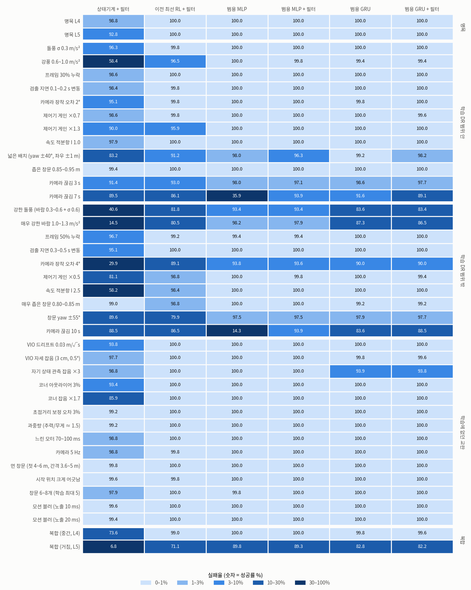

| 묶음 (조건 수) — 평균 / 최저 성공 % | 상태기계 + 필터 | 이전 최선 RL + 필터 | 범용 MLP | **범용 MLP + 필터** | 범용 GRU | 범용 GRU + 필터 |
|---|---|---|---|---|---|---|
| 명목 (2) | 95.8 / 92.8 | 100 / 100 | 100 / 100 | **100 / 100** | 100 / 100 | 100 / 100 |
| 학습 DR 범위 안 (12) | 91.4 / 58.4 | 96.8 / 86.1 | 94.3 / 35.9 | **98.9 / 93.9** | 99.1 / 91.6 | 98.7 / 89.1 |
| 학습 DR 범위 밖 (10) | 69.3 / 14.5 | 91.3 / 79.9 | 89.6 / 14.3 | **97.5 / 93.4** | 94.2 / 83.6 | 94.5 / 83.4 |
| 학습에 없던 교란 (14) | 97.3 / 85.9 | 100 / 99.8 | 100 / 99.8 | **100 / 100** | 99.6 / 93.9 | 99.5 / 93.8 |
| 복합 (2) | 40.2 / 6.8 | 85.1 / 71.1 | 94.9 / 89.8 | **94.6 / 89.3** | 91.3 / 82.8 | 90.9 / 82.2 |
| 검출 전무 — 충돌 % | 0 | 0 | 100 | **0** | 67 | 0 |

(이전 최선 RL = 검출 공백 관측 정책 `robust_gap10` + 망각 계수 0.8.)

- **범용 MLP + 필터가 모든 묶음에서 가장 높거나 같다.** 상태기계 + 필터 대비 같은 장면 짝 비교로: 매우 강한 바람 14.5 → 97.9%
  (상태기계만 성공 0 : 범용만 427), 장착 오차 4° 29.9 → 93.6% (2 : 328), 복합 거침 6.8 → 89.3% (4 : 426), 창문 yaw ±55°
  89.6 → 97.5% (10 : 50), 넓은 배치 83.2 → 96.3% (7 : 74), 7 s 끊김 89.5 → 93.9% (30 : 53, p = 0.015). 상태기계가 앞서는 조건은 없다.
- **이전 최선 RL 대비** 넓은 배치 91.2 → 96.3, yaw ±55° 79.9 → 97.5, 매우 강한 바람 80.5 → 97.9, 복합 거침 71.1 → 89.3%
  (모두 p < 1e-4). 명목 시간은 같다 (L5 10.4 s).
- **새 필터만으로** 범용 MLP 의 7 s 끊김 69.7 → 93.9% (147 : 23), 10 s 69.5 → 93.9%. 3 s 끊김·다른 조건은 차이 없음
  (넓은 배치 97.5 → 96.3%, p = 0.07). 상태기계 + 필터도 3 / 7 s 끊김 85.0 / 81.4 → 91.4 / 89.5%.
- 학습에 없던 교란 14 종(창문 6~8 개, 모션 블러 포함)에서 범용 MLP 는 전부 100% 다. 넓게 학습해도 처음 보는 교란에서 잃은 것이 없다.
- 남은 약점: 복합 거침 89% (실패 대부분 벽 충돌), 강한 돌풍 93%, 장착 오차 4° 94%, 7 s 끊김 94%.

**기억(GRU)** 은 긴 끊김을 정책 혼자 버틴다 (7 s 끊김 단독 91.6 vs MLP 35.9%; 끊긴 동안 속도를 0.6 m/s 로 줄였다가 다시 나는
것을 스스로 배웠다 — 다만 위 MLP0 비교로 보면 대부분은 기억이 아니라 처음부터 학습한 덕이다). 하지만 학습 범위 밖 바람(87.3 vs 97.9%, 3 : 57), 강한 돌풍(83.6 vs 93.4%), 자기 상태 관측 잡음 ×3
(93.9 vs 100%, 0 : 31), 복합 거침(82.8 vs 89.3%)에서 범용 MLP + 필터보다 낮다. 필터는 GRU 에 검출 전무 대비 말고는 보태는 것이
없다 (7 s 끊김 91.6 → 89.1%).

**Isaac (PhysX) 확인** — 범용 MLP + 필터(고른 설정), GPU 난수 장면 512 개, 같은 장면을 torch 와 짝 비교
(`/data/runs/isaac_check_final2.sh`, `/data/runs/rl_planner/isaac_check_final`):

| 조건 | torch 성공 % | Isaac 성공 % | 같은 결과 장면 | torch만 : Isaac만 (p) | 완료 시간 torch / Isaac [s] |
|---|---|---|---|---|---|
| 명목 L4 | 100.0 | 100.0 | 512 / 512 | 0 : 0 | 11.18 / 11.18 |
| 명목 L5 | 100.0 | 100.0 | 512 / 512 | 0 : 0 | 10.66 / 10.66 |
| 넓은 배치 | 95.1 | 95.5 | 506 / 512 | 2 : 4 (p = 0.69) | 11.20 / 11.21 |
| 매우 강한 바람 | 98.2 | 98.0 | 507 / 512 | 3 : 2 (p = 1) | 11.76 / 11.77 |
| 카메라 끊김 7 s | 94.1 | 94.9 | 502 / 512 | 3 : 7 (p = 0.34) | 15.94 / 15.92 |
| 복합 (거침, L5) | 86.7 | 85.7 | 477 / 512 | 20 : 15 (p = 0.5) | 10.35 / 10.31 |

물리 엔진이 달라도 결과가 같다 (유의한 차이 없음, 장면별 일치 93~100%). 아슬아슬한 장면이 많은 복합 거침에서 일치가 가장 낮다.
(GPU 장면이라 CPU 평가 세트 숫자와는 조금 다르다.)

### 배포 권장 (갱신 — §5 끝의 권장을 대체)

- **범용 MLP 정책(`gen_mlp`) + 안전 필터 (제동 정지점 1.5 m/s² + 깜깜이 감속 2 s)**. 이전 권장 두 정책보다 모든 묶음에서 높거나
  같고, 명목 시간은 같다 (L5 10.4 s). 망각 계수 0.8 은 정책 설정(policy_meta)에 들어 있어 `OnboardPlanner` 가 그대로 쓴다.
  고른 필터 설정은 `configs/default.yaml` 의 기본값으로 바꿨다 (온보드 기본 적용).
- 기억(GRU) 정책은 끊김에 강하지만 범위 밖 바람·관측 잡음에 약해 후보가 아니다. 카메라가 자주 몇 초씩 끊기는 기체라도
  범용 MLP + 필터가 7 s 끊김에서 같거나 낫다 (93.9 vs 91.6%).
- 실기로 옮기기 전에 남은 것은 그대로다: 실제 검출기, 팀 PID, VIO 지연 (§8). 팀 PID 는 게인 ×0.5~1.3·적분항 2.5 까지
  흉내 냈을 때 범용 MLP 가 99.8~100% 였으므로 재학습 없이도 시작점은 된다.

## 11. 속도 — 빠르고 정확하게 (10/27 오후~밤)

> 요청: "robustness 를 확보하면 파인튜닝 등으로 스피드를 확보 — 창문을 아주 빠르고 정확하게 통과하도록".

**속도를 막던 것은 정책이 아니라 행동 범위였다.** 행동 [-1, 1] 은 웨이포인트 변위 × `action.step_max` = [0.8, 0.6, 0.4] m 이고,
Lee 제어기는 0.8 m 앞 웨이포인트를 kp_pos 1.6 × 0.8 = 1.28 m/s 로 쫓는다. 정책은 평균 1.17 m/s 로 이 상한에 붙어 날았고
(§6), 출력은 자주 ±1 밖이라 잘렸다. 기체 속도 한계(planner_limits v_max)는 2.0 m/s 다.

준비한 것:

- `scripts/rescale_action.py`: 학습된 체크포인트를 큰 `step_max` 로 옮긴다. 출력층·탐색 잡음·Adam 상태와 관측 속 이전 행동의
  정규화를 같은 비율로 고쳐, 잘리지 않던 행동은 같은 변위를 낸다 (테스트). 범용 MLP 를 [1.25, 0.9, 0.5] m (전진 2.0 m/s) 로
  옮기기만 해도 (학습 없이) 명목 L5 10.44 → **7.05 s** (성공 99.6%, 256 장면) — 정책이 원래 더 빨리 가려 했다는 뜻이다.
  대신 매우 강한 바람 95.7 → 76.6% 로 떨어져, 빠른 비행에 맞춘 미세조정이 필요하다.
- **모션 블러** (`perception.exposure_s`): 빨리 날수록 영상이 번진다. 이게 없으면 시뮬에서는 속도가 공짜다 (위 §10 교란 표).
  지금 속도(1.2 m/s)에서는 노출 20 ms 도 영향이 없었다 (평가 세트 모든 RL 100%).
- `configs/train/speed.yaml`: 범용 프리셋 위에 보폭 상한 [1.25, 0.9, 0.5] + 노출 DR 0~10 ms.

### 1차 미세조정 — 32% 빨라졌지만 어려운 조건에서 약해졌다

범용 MLP model_3997 을 재척도한 웜스타트에서 1200 반복씩 (torch 4096 환경, 1 h 54 m):
`speed_a` 보상 그대로, `speed_b` 시간 벌점 −0.02 → −0.05, `speed_c` 팀 운용 한계로 학습 (`speed_ops.yaml`: 제어기 1.6 m/s ·
1.6 m/s², 보폭 1.0 m, 1.0 m 재척도 웜스타트). 평가 시드, 고른 필터 (제동 1.5 + 감속 2 s):

| | 상태기계 + 필터 | 범용 MLP + 필터 | speed_a + 필터 | speed_b + 필터 | speed_c + 필터 |
|---|---|---|---|---|---|
| 명목 L5 성공 % · 완료 s · 통과 여유 m | 92.8 · 16.6 · 0.163 | 100 · 10.4 · 0.176 | 99.8 · **7.1** · 0.168 | 99.8 · **7.1** · 0.168 | 100 · 8.7 · 0.172 |
| 명목 L5 · 팀 운용 한계 (1.6 m/s, 1.6 m/s²) | 91.8 · 17.1 | 100 · 10.5 | 100 · **8.2** | 100 · 8.2 | 100 · 8.7 |
| 묶음 평균 성공 %: DR 안 / 밖 / 처음 보는 교란 / 복합 | 91.4 / 69.3 / 97.3 / 40.2 | **98.9 / 97.5 / 100 / 94.6** | 94.3 / 92.4 / 99.9 / 87.9 | 95.2 / 93.2 / 99.9 / 87.1 | 96.9 / 91.6 / 100 / 86.3 |
| 41 조건 평균 완료 s | 18.0 | 11.9 | 8.1 | 8.1 | 10.0 |

- **빨라졌다**: 명목 L5 10.4 → 7.1 s (−32%), 41 조건 평균 11.9 → 8.1 s. 명목 성공률과 통과 여유(0.176 → 0.168 m)는 거의 그대로,
  모션 블러 10·20 ms 도 100%. 팀 운용 한계를 제어기에 걸어도 8.2 s (−21%).
- **시간 벌점은 속도를 바꾸지 못했다** (speed_b = speed_a). 정책은 이미 새 상한 2.0 m/s 에 붙어 난다 — 속도를 정하는 것은 보상의
  시간 벌점보다 할인(γ = 0.99, 10 Hz)이다: 같은 보상도 빨리 받을수록 덜 깎인다.
- **팀 한계로 따로 학습할 필요는 없었다**: 2.0 m/s 로 학습한 speed_a 를 운용 한계 제어기에서 날리면 8.2 s, 한계로 학습한 speed_c 는
  8.7 s. speed_c 는 매우 강한 바람 77% 로 약한데, 이 시뮬에서 a_max 1.6 은 계획 한계가 아니라 바람을 버티는 제어 권한까지 깎기
  때문이다 (실제 팀 규칙은 계획기 출력 한계 — 이 모델은 바람에 대해 비관적).
- **약해진 곳** (speed_a + 필터 vs 범용 MLP + 필터, 같은 장면 짝 비교): 카메라 끊김 3 / 7 / 10 s 97.1 / 93.9 / 93.9 → 73.6 / 64.6 /
  64.6% (12 : 132 등, 모두 p < 1e-4), 복합 거침 89.3 → 75.8% (27 : 96), 장착 오차 4° 93.6 → 80.3% (11 : 79), yaw ±55° 97.5 → 92.8%
  (10 : 34), 매우 강한 바람 97.9 → 95.3% (4 : 17), 매우 좁은 창문 100 → 98.8% (0 : 6). 학습 중 성공률도 0.77 → 0.70.

원인은 두 가지였다.

### 원인 1 — 안전 필터가 빠른 정책을 창문 코앞에 세운다 → 정지 비행 '되짚어 물러나기'

speed_a 는 필터를 켜면 오히려 끊김에서 나빠졌다 (7 s 끊김 단독 78.3 → 필터 64.6%, 시간 초과 21%). 진단 (검증 시드 L4 512 장면,
`scripts/hold_timeout.py`): 시간 초과 108 개는 모두 정지 비행이 끝까지 풀리지 않은 것이다. 기체는 아직 추정하지 못한 다음 창문 앞
1.6 m (중앙값)에 서 있었고, 창문 중심보다 0.3 m 높거나 옆으로 비켜 있어 네 코너가 한 화면에 들어오지 않았다 (세로 화각 ±25°).
검출이 없으니 정지가 풀리지 않는다 — 교착. 1.1 m/s 로 나는 범용 MLP 는 더 멀리서 서서 같은 일이 10 번뿐이었다.

고친 것: `safety.retreat_after_s` — 정지 비행이 그 시간 넘게 아무것도 못 보면, 마지막 창문 통과 뒤 날아온 경로(0.1 m 간격 기록)를
0.3 m/s 로 되짚어 최대 3 m 물러난다. 날아온 경로는 비어 있다는 것이 확인된 공간이고(통과한 창문 0.6 m 앞에서 멈춤), 물러나면
창문이 다시 화면에 들어온다. 비전으로 길을 찾는 드론이 신호를 잃으면 온 길을 되짚는 것과 같은 방식이다. 기본은 끔 (끄면 기존과
비트 단위 동일), 테스트 `test_safety_hold_retraces_the_path_flown_since_the_last_pass`.

검증 시드 7 s 끊김 L4: speed_a 성공 363 → **459** / 512 (시간 초과 108 → 13, 충돌 41 → 40), 범용 MLP 480 → 479 (변화 없음).

41 조건 검증 시드 (`scripts/filter_grid.py`, 공통 조건 평균 성공 % · 7 s 끊김 %):

| 계획기 + 고른 필터 | 되짚기 없음 | **되짚기 1 s** | 같은 장면 짝 비교 (되짚기 없음만 : 있음만) |
|---|---|---|---|
| 범용 MLP | 98.59 · 93.8 | 98.62 · 93.6 | 가장 나쁜 조건 2 : 1 (p = 1) |
| speed_a | 96.03 · 70.9 | **97.27 · 89.6** | 끊김 3 / 7 / 10 s 0 : 64, 6 : 102, 5 : 104 |
| speed_b | 96.57 · 78.5 | 97.27 · 88.5 | |
| speed_c | 96.38 · 80.1 | 97.08 · 91.6 | 끊김 3 / 7 / 10 s 0 : 30, 2 : 61, 6 : 60 |
| 상태기계 (제동 1.5 + 감속 1 s) | 84.52 · 86.5 | 84.86 · 89.1 | 매우 강한 바람 0 : 6 |

모든 계획기가 좋아지고 나빠진 조건은 없다 (검출 전무 충돌 0% 그대로). **기본값으로 켰다** (`safety.retreat_after_s: 1.0`,
온보드 기본 적용). 되짚기 매개변수(1 s, 0.3 m/s, 최대 3 m)는 미리 정한 값이고 따로 고르지 않았다. 이 기본값 이전 결과 루트를
다시 돌리는 스크립트(`/data/runs/bench_*.sh`)는 `--set safety.retreat_after_s=null` 로 고정했다.

### 원인 2 가설 — 보상 (할인이 속도를 사고, 충돌 벌점은 그대로다) → 기각

할인 γ = 0.99 (10 Hz) 에서 같은 보상을 10.4 s 대신 7.1 s 에 받으면 할인된 값이 커진다 (에피소드 보상 ~70 을 고르게 받는다고 치면
43.6 → 50.3, +6.7). 충돌이 7% 늘어나는 손해(벌점 −20 + 잃은 남은 보상, 대략 −2.6)보다 크다. 그래서 위험을 더 비싸게 만들면
정책이 위험할 때만 느려질 것이라는 가설로 2차 미세조정 3 개를 돌렸다 (speed_a model_5196 에서 1500 반복씩, 2 h 20 m,
`/data/runs/queue_speed2.sh`). 검증 시드, 고른 필터 + 되짚기:

| | 범용 MLP | speed_a | `speed_e` 보상 그대로 (대조) | `speed_d` 충돌 −40 | `speed_f` 충돌 −40 + γ 0.995 |
|---|---|---|---|---|---|
| 41 조건 평균 성공 % · 평균 완료 s | 98.75 · 12.1 | 97.27 · 8.3 | 96.91 · 8.3 | 96.83 · 8.3 | 96.74 · 8.3 |
| 명목 L5 성공 % · 완료 s | 100 · 10.5 | 99.8 · 7.1 | 99.8 · 7.1 | 99.8 · 7.1 | 100 · 7.2 |
| 복합 거침 / yaw ±55° / 넓은 배치 / 7 s 끊김 % | 86.9 / 96.1 / 96.5 / 93.6 | 77.1 / 90.2 / 92.4 / 89.6 | 76.8 / 88.7 / 92.8 / 84.8 | 75.0 / 90.8 / 92.0 / 86.1 | 75.4 / 89.5 / 94.1 / 85.5 |
| 학습 마지막 100 반복: 성공 · 충돌 · 에피소드 s | 0.77 · 0.23 · 10.4 | 0.70 · 0.30 · 7.5 | 0.72 · 0.27 · 7.7 | 0.71 · 0.29 · 7.7 | 0.72 · 0.28 · 7.7 |

셋 다 speed_a 와 같다 — 속도도, 강건성도, 학습 중 충돌률도. 충돌 벌점을 두 배로 하면 탐색 잡음만 커졌다 (엔트로피 2.95 → 3.24).
돌아보면 충돌은 이미 남은 창문 보상(~40)을 잃는 일이라 −20 → −40 은 판돈을 절반도 바꾸지 않고, 정책이 '위험한 상태'를 관측으로
구별하기도 어렵다 (장착 오차·기운 창문은 겉보기에 명목과 같다). 2차 정책은 쓰지 않는다.

### 진짜 원인 — 창문을 지날 때의 조준 오차

`scripts/pass_budget.py` (검증 시드, 정책 단독, 512 장면): 창문을 지나는 순간, 창문 평면 안에서 추정 오차(추정 중심 − 실제 중심)와
조준 오차(기체 − 추정 중심)를 나눴다.

| 조건 | 계획기 | 통과 속도 m/s | 그 창문을 본 프레임 | 추정 오차 cm | 조준 오차 cm (p95) | 벽 충돌 / 512 |
|---|---|---|---|---|---|---|
| 명목 L5 | 범용 MLP | 1.20 | 26.2 | 2.5 | 3.6 (8.1) | 0 |
| | speed_a | 1.88 | 17.5 | 3.2 | **6.4** (13.2) | 1 |
| yaw ±55° L4 | 범용 MLP | 1.20 | 28.4 | 2.7 | 4.2 (10.8) | 20 |
| | speed_a | 1.87 | 19.2 | 3.7 | **7.6** (16.1) | 49 |
| 넓은 배치 L4 | 범용 MLP | 1.21 | 24.1 | 4.1 | 6.1 (10.8) | 9 |
| | speed_a | 1.88 | 16.0 | 7.4 | **11.7** (16.9) | 40 |
| 복합 거침 L5 | 범용 MLP | 1.29 | 13.7 | 12.5 | 9.1 (21.8) | 66 |
| | speed_a | 2.05 | 9.2 | 18.0 | **15.8** (36.6) | 119 |

- **조준 오차가 두 배다.** 추정이 맞아도 기체가 추정 중심을 덜 정확히 지난다. 창문 간격 2.6~3.6 m 를 1.9 m/s 로 날면 한 구간이
  ~1.6 s 로, 위치 제어 시정수(1/kp_pos = 0.63 s)의 2.5 배뿐이다 — 옆으로 0.6 m 옮겨 가면 ~5 cm 가 남는다 (1.2 m/s 에서는 4 배, ~1 cm).
- **추정기는 같다.** 같은 프레임 수끼리 비교하면 추정 오차가 같다 (명목 12~16 장 2.7 vs 2.8 cm, 16~24 장 2.7 vs 2.5 cm).
  빠른 정책은 창문마다 덜 볼 뿐이다 (명목 26 → 17.5 장; 복합 거침에서 8 장 미만으로 지난 통과 216 → 661 회, 그때 추정 오차 26 cm).
- **부딪히는 곳은 창문 틀이다.** speed_a 의 충돌은 평면 0.15~0.25 m 앞, 중심에서 0.32~0.44 m 벗어난 곳이다. 넓은 배치에서는
  ~4 프레임밖에 못 본 창문에 부딪혔다 (40 번 중 21 번은 유효 추정 없음).

### 속도 다이얼 — 배치할 때 제어기 속도 상한만 낮추기 (재학습 없음)

speed_a 에서 제어기 수평 속도 상한만 바꿈 (a_max 그대로, `/data/runs/val_vmax.sh`), 검증 시드, 고른 필터 + 되짚기:

| 속도 상한 | 명목 L5 s | 41 조건 평균 성공 % · 완료 s | 복합 거침 | 7 s 끊김 | 매우 강한 바람 | 장착 4° | yaw ±55° | 넓은 배치 |
|---|---|---|---|---|---|---|---|---|
| 2.0 m/s (그대로) | 7.1 | 97.27 · 8.3 | 77.1 | 89.6 | 95.3 | 78.9 | 90.2 | 92.4 |
| **1.6 m/s** | 8.1 | **98.07** · 9.3 | 85.4 | 93.2 | 97.9 | 84.2 | 90.2 | 94.7 |
| 1.3 m/s | 9.8 | 97.80 · 11.0 | 85.5 | 90.6 | 98.8 | 87.3 | 88.9 | 91.8 |
| 범용 MLP (상한 1.28 m/s) | 10.5 | 98.75 · 12.1 | 86.9 | 93.6 | 97.3 | 95.5 | 96.1 | 96.5 |

1.6 m/s 에서 복합 거침·끊김·바람은 범용 MLP 수준으로 돌아온다 (속도 탓이었다). yaw ±55°·넓은 배치는 속도를 낮춰도 그대로이고
장착 4° 는 낮출수록 조금씩 좋아지지만 범용 MLP 와 멀다 — 이쪽은 빠른 비행에 맞춰 바뀐 정책 자체의 약점이다. 1.3 m/s 가 1.6 보다
나쁜 조건도 있다 (그렇게 느리게 날도록 학습되지 않았다).

### 실패한 시도 — 안정 접근 관문 (되돌림)

항공기의 안정 접근 기준처럼, 창문 추정 평면 1.5 m 안에서 접근이 불안정하면 (추정 σ > 0.1 m, 프레임 < 8, 추정 중심에서
0.05 + 0.3 × 거리 넘게 벗어남) 전진 보폭만 줄이는 안전 필터 규칙을 넣어 봤다 (커밋 0042985, `/data/runs/val_gate.sh`).
검증 시드 핵심 10 조건 평균 성공 % · 명목 L5 s: 끔 92.3 · 7.1 → 관문 80.8 · 10.0, 추정 없을 때도 줄임 81.4, 2.0 m 77.2,
전진 상한 0.7 배 90.8 · 8.5, 좁은 깔때기 80.5 — 모두 나쁘거나 느렸다. 명목 비행에서도 결정 스텝의 57% 에 걸리고 비행 하나에
~10 번 켜졌다 꺼졌다. 문턱을 명목 비행으로 맞추지 않은 탓도 있지만, 창문 앞에서 전진만 갑자기 줄이면 그렇게 학습되지 않은
정책이 흔들린다. 같은 속도 제한이라도 비행 내내 일정한 제어기 상한(위)은 문제가 없었다. 되돌렸다 (ab5f001).
명목 비행에서는 걸리지 않게 문턱을 맞춘 관문은 시험하지 않았다.

### 평가 시드 — 되짚기를 켠 비교

평가 시드 12345, 41 조건 × 같은 장면 512 개, 필터 + 되짚기 (`/data/runs/bench_final_r.sh`; 팀 한계는 `/data/runs/bench_ops.sh` —
모든 조건에 제어기 1.6 m/s · 1.6 m/s²):

| | 상태기계 + 필터 | 범용 MLP + 필터 | speed_a + 필터 |
|---|---|---|---|
| 기체 한계 (2.0 m/s, 2.0 m/s²): 명목 L5 성공 % · 완료 s · 통과 여유 m | 93.4 · 16.7 · 0.163 | 100 · 10.4 · 0.176 | 99.8 · **7.1** · 0.168 |
| 〃 묶음 평균: DR 안 / 밖 / 처음 보는 교란 / 복합 | 91.7 / 69.8 / 97.4 / 40.7 | **99.0 / 97.7 / 100 / 94.7** | 97.0 / 94.3 / 99.9 / 88.0 |
| 〃 41 조건 평균 성공 % · 완료 s | 86.1 · 18.1 | **98.9** · 11.9 | 97.1 · **8.2** |
| 팀 운용 한계 (1.6 m/s, 1.6 m/s²): 명목 L5 성공 % · 완료 s | 92.6 · 17.2 | 100 · 10.5 | 100 · **8.2** |
| 〃 묶음 평균: DR 안 / 밖 / 처음 보는 교란 / 복합 | | 98.8 / 93.1 / 100 / 88.9 | 98.1 / 91.4 / 99.9 / 82.9 |
| 〃 41 조건 평균 성공 % · 완료 s | | 97.4 · 12.0 | 96.5 · **9.4** |

팀 운용 한계에서 speed_a 가 범용 MLP 보다 유의하게 약한 조건 (같은 장면 짝): 장착 오차 4° 86.1 vs 93.8% (11 : 50), 복합 거침
66.0 vs 77.7% (47 : 107), yaw ±55° 94.5 vs 97.5% (7 : 22), 끊김 3 s 93.4 vs 97.7% (12 : 34). 나머지 37 조건은 차이가 없다
(p > 0.05). 이 시뮬에서 a_max 1.6 은 바람을 버티는 제어 권한까지 깎아 바람 조건은 두 정책 모두 낮다 (비관적).

Isaac(PhysX) 확인 (`/data/runs/isaac_check_policy.sh speed_a`, 같은 장면 GPU 난수, 필터 + 되짚기):

| 조건 | torch 성공 % | Isaac 성공 % | 같은 결과 장면 | torch 만 : Isaac 만 (p) | 완료 s torch / Isaac |
|---|---|---|---|---|---|
| 명목 L4 | 100.0 | 100.0 | 512 / 512 | 0 : 0 | 7.53 / 7.54 |
| 명목 L5 | 99.8 | 99.8 | 512 / 512 | 0 : 0 | 7.21 / 7.21 |
| 넓은 배치 | 91.2 | 90.2 | 495 / 512 | 11 : 6 (p = 0.33) | 7.59 / 7.59 |
| 매우 강한 바람 | 94.9 | 94.3 | 493 / 512 | 11 : 8 (p = 0.65) | 7.86 / 7.86 |
| 7 s 끊김 | 84.4 | 86.7 | 472 / 512 | 14 : 26 (p = 0.081) | 12.48 / 12.49 |
| 복합 거침 | 75.0 | 74.2 | 454 / 512 | 31 : 27 (p = 0.69) | 7.02 / 7.04 |

빠른 정책도 물리 엔진이 달라도 결과가 같다. 같은 장면 비교 영상 (Isaac RTX, 넓은 배치 L4 seed 4, 창문 5 개, 필터 없이):
`/data/runs/rl_planner/media/compare_gen_vs_speed_geomwide_L4_seed4.gif` — 범용 13.2 s, speed_a 9.0 s, 둘 다 5 / 5.

### 3차 미세조정 — 정확도 손잡이: 지나는 자리는 좁아졌지만 강건성은 그대로

원인이 조준 오차이므로 정확도를 직접 겨냥했다 (speed_a model_5196 에서 1500 반복씩, `/data/runs/queue_speed3.sh`):
`speed_g` 통과 여유 보상 5 → 15 (가운데로 지날수록 큰 보너스), `speed_h` 탐색 잡음 상한 `train.policy.std_max` 1.0 → 0.3
(학습 중 정책 잡음 σ ≈ 0.63 — 웨이포인트로 ±0.6~0.8 m — 이 정밀한 조준을 배우기 어렵게 한다는 가설; 엔트로피 2.9 → 0.2~0.3),
`speed_i` 둘 다. 학습 끝 성공률은 셋 다 0.72 로 대조군 speed_e 와 같다.

검증 시드 4242, 41 조건 × 같은 장면 512 개. 위 세 행은 배치 설정(필터 + 되짚기), 아래 두 행은 정책 단독 (`scripts/pass_budget.py`):

| | speed_a | speed_g (여유 ×3) | speed_h (잡음 ≤ 0.3) | speed_i (둘 다) |
|---|---|---|---|---|
| 평균 성공 / 충돌 / 시간 초과 % | 97.27 / 2.47 / 0.26 | 97.07 / 2.33 / 0.60 | 97.26 / 2.49 / 0.25 | 97.29 / 2.43 / 0.28 |
| 같은 장면 짝, 41 조건 합 (새 정책만 : speed_a 만) | | 257 : 299 (p = 0.08) | 224 : 227 (p = 0.92) | 247 : 243 (p = 0.89) |
| 명목 L5 완료 s · 통과 여유 m | 7.1 · 0.169 | 7.1 · 0.174 | 7.1 · 0.171 | 7.1 · 0.175 |
| 명목 L5 통과 순간 실제 중심에서 벗어난 거리 cm (p95) | 5.4 (11.5) | 4.5 (9.6) | 5.0 (10.5) | 4.4 (9.6) |
| 벽 충돌 / 512: yaw ±55° L4 · 넓은 배치 L4 · 복합 거침 L5 | 49 · 40 · 118 | 46 · 37 · 117 | 50 · 38 · 125 | 54 · 41 · 112 |

- **지나는 자리는 좁아졌다.** 여유 보상을 키우면 실제 중심에서 벗어난 거리가 17% 줄고 (p95 11.5 → 9.6 cm) 통과 여유가 5 mm
  늘었다. 속도는 그대로다. 보상이 실제 창문 기하로 계산되므로 추정 중심보다 실제 중심 쪽으로 더 좁혀졌다 (추정 중심 기준 조준
  오차는 6.4 → 5.6 cm).
- **충돌은 그대로다.** 충돌은 평소 조준 오차가 아니라, 창문을 몇 프레임밖에 못 보고 0.3~0.5 m 비켜 다가간 접근에서 난다 (위
  '진짜 원인'). 탐색 잡음 상한은 아무것도 바꾸지 않았다.
- **speed_g 는 필터와 맞지 않는다.** 정책 단독에서는 speed_a 보다 유의하게 낫다 (41 조건 합 393 : 307, p = 0.001; 장착 오차 4°
  83.4 vs 79.1%). 그러나 필터 + 되짚기를 켜면 긴 끊김에서 나빠진다 (7 s 82.8 vs 89.6%, 20 : 55; 10 s 82.6 vs 89.3%, 19 : 53;
  둘 다 p < 1e-4). 7 s 끊김 L4 의 시간 초과 13 → 42 개는 모두 다음 창문 앞 2.3 m (중앙값), 창문 중심보다 0.64 m 위 (42 개 중 40
  개가 0.35 m 넘게) 에서 끝까지 정지했다. 되짚어 물러나도 네 코너가 세로 화각에 다 들어오지 않는다 (`scripts/hold_timeout.py`).
  장착 오차 4° 에서는 필터를 켜도 speed_g 가 낫다 (83.0 vs 78.9%, 46 : 25, p = 0.017).
- **결론: speed_a 를 그대로 쓴다.** 세 손잡이 모두 배치 설정에서 강건성을 바꾸지 못했다. 빠른 정책의 남은 약점은 보상이 아니라
  2 m/s 에서 창문마다 보는 프레임 수와 위치 제어 지연에서 온다. 그래서 정책 밖 손잡이로 다룬다: 속도 다이얼, 카메라·검출기
  속도 (§8 다음 단계).

### 배포 권장 (최종)

- **빠르게: speed_a + 안전 필터 (되짚기 포함 기본값).** 팀 운용 한계 1.6 m/s 에서 명목 8.2 s (범용 MLP 10.5 s 보다 22% 빠름),
  41 조건 평균 성공 96.5 vs 97.4%. 기체 한계 2.0 m/s 를 허용하면 7.1 s (−32%), 97.1 vs 98.9%.
- **강건하게: 범용 MLP + 안전 필터.** 카메라 장착이 2° 넘게 틀어질 수 있거나, 창문이 40° 넘게 기울어 있거나, 거친 복합 조건이
  예상되면.
- **중간: speed_a 를 제어기 속도 상한 1.6 m/s 로 (재학습 없음).** 검증 시드에서 명목 8.1 s, 41 조건 평균 98.07% — 복합·끊김·바람
  손실은 돌아오고 장착 오차·yaw ±55°·넓은 배치 손실은 남는다 (위 속도 다이얼).
- 두 정책은 같은 온보드 인터페이스(`planners/onboard.py`)에 export 디렉터리만 바꿔 끼운다.
- 검증하지 않은 것: 2 m/s 에서의 실제 모션 블러·검출기, 속도에 따른 VIO 지연.

## 12. 엉뚱한 배치·창문 50 개 — 통과 직후 둘러보고 가장 가까운 창문으로 (10/28)

> 요청: "50 개 정도의 극한 환경에서도 잘 통과하도록. 창문을 엉뚱한 데 배치해서 창문 통과 직후에 드론이 적절한 스캔 모션을 하고
> 주변 탈출구를 파악해서 이동하도록 하는 강건성", "판단 기준은 창문 통과 직후 더 가까운 창문으로 통과하기",
> "적절한 스캔 모션이 있어서 상하좌우를 다 스캔할 수 있어야 해".

**결론**: 학습한 둘러보기 정책 **scan_c2** 가 창문 50 개 꺾인 코스의 70% 를 끝까지 간다 (평가 시드 512 코스, 필터 포함 69.9%,
창문당 99.3%, 약 135 s). 극한 배치는 37%, 학습 없는 둘러보기(상태기계)는 50 개에서 모두 0%. 통과 직후 다음 창문이 안 보이면 좌우로
50° 가량 돌고 위아래로 0.3 m 가량 오르내려 0.7 s 안에 찾는다. 약점은 바람·카메라 장착 오차와, 찾은 뒤에도 고개를 계속 흔드는 움직임이다.
요청 그대로 "다 훑은 뒤에 고르기" 를 규칙(스캔 게이트)으로 넣어 학습한 정책은 순서 위반을 49 → 4 건으로 거의 없앴지만 판에 네 배
자주 부딪혀 (완주 31%) 아직 배포하지 않는다. Isaac PhysX 에서도 결과가 같다.

### 환경 — 꺾인 코스 (`scene.layout: scatter`, `configs/scan/course.yaml`)

- **배치**: 다음 창문을 직전 창문(첫 창문은 시작점)에서 거리 2.5~4.5 m, 그 창문을 빠져나가는 방향 대비 좌우 최대 **90°**,
  높이 변화 **±1.2 m** (창문 중심 0.8~2.6 m), 창문 기울기 ±30° 로 놓는다. 카메라 화각은 좌우 ±40°, 위아래 ±25° 라 통과 직후
  다음 창문이 화면 밖인 경우가 많다 — 둘러봐야 찾는다.
- **판단 기준** (요청 그대로): 창문을 통과한 직후 (시작할 때는 시작점에서), 아직 안 지난 창문 중 방금 지난 창문에서 **가장 가까운**
  창문으로 간다. 생성기는 이 규칙이 곧 코스 순서가 되도록 놓고, 나머지 창문은 모두 1.25 배 넘게 멀게 둔다 (거리가 애매한 배치는
  없음). 다른 창문을 먼저 지나면 실패(순서 위반)로 판정한다.
- **벽**: 창문마다 1.6 m 정사각형 판 (그 밖으로는 돌아갈 수 있음). 이웃 창문 사이 직선 경로(+ 지난 창문 뒤 1 m)는 다른 판에서
  0.4 m 넘게 떨어지고, 창문 중심끼리는 2.4 m 넘게 떨어진다. 경기장은 폭 24 m 복도, 천장 3.5 m. 시간 제한 10 s + 창문당 8 s.
- **창문 50 개** (`configs/scan/long50.yaml`): 512 코스 모두 50 개가 놓였고 규칙 위반은 0 개다 (테스트
  `test_scatter_course_orders_windows_by_the_nearest_exit_rule`). 레벨 L0~L5 는 꺾임·높이 변화·검출 잡음을 키운다
  (L0: 창문 2~3, 꺾임 ≤ 20°, ±0.3 m → L4: 창문 4~8, ≤ 90°, ±1.2 m → L5: 창문 5~10, 거친 검출 σ 4~12 px·누락 5~20%).
  **극한 배치** (`configs/scan/extreme.yaml`): 높이 변화 ±1.6 m (창문 중심 0.7~2.8 m), 기울기 ±40°, 간격 2.5~5 m, 거친 검출.

### 정책이 보는 것과 하는 것

- **목표 고르기** (`mission.selection: nearest`, `core/selector.py`): 지금까지 본 적 있는, 아직 안 지난 창문 중 기준점
  (방금 지난 창문의 추정 중심)에서 가장 가까운 창문. 거리는 삼각측량 중심, 아직 없으면 단안 추정 (초점거리 × 1 m / 가장 긴 변 픽셀).
  **아직 못 본 더 가까운 창문은 후보가 아니다** — 충분히 둘러보지 않고 가면 순서 위반이 된다. 정책의 목표 관측은 이 선택만 본다
  (판정·보상·비평가는 실제 순서).
- **yaw 를 직접 돌린다**: 4번째 행동 = yaw 변화율 (±90°/s). 카메라가 몸체에 고정이라 **좌우는 몸을 돌려, 위아래는 고도를 바꿔** 훑는다.
- **어디까지 둘러봤는지** (`search_state`, 10): 빠져나간 방향 대비 지금 방향 (sin, cos), 통과 뒤 돌아본 방향의 최대·최소, 통과 고도
  대비 지금·최고·최저 고도, 통과 뒤 시간, 아는 후보 수, 목표 있음. 기억 없는 MLP 도 "왼쪽은 봤으니 오른쪽, 그다음 위·아래" 를 할 수 있다.
- **방금 지난 창문** (`last_pass`, 8): 그 창문 추정 기준 기체 위치 (지나온 방향·왼쪽·위), 지나온 방향, 고른 후보와 차점 후보의 거리.
  통과 직후 꺾다가 방금 지난 창문 판을 스치는 사고와 먼 후보를 고르는 실수를 줄이려고 넣었다.
- **온보드**: 같은 선택기와 yaw 설정점(`out["yaw"]`)을 `OnboardPlanner` 가 낸다. 학습 환경과 관측·행동·yaw 가 정확히 같다
  (`tests/test_onboard.py`). 팀 `waypoints_config` 에는 yaw 가 없어 제어기 쪽에 yaw 입력이 필요하다 (§8 결정 7).
  검출의 `order_index` 는 여기서는 추적 번호일 뿐이다 (색 = 순서가 아님) — 실기에는 창문 추적기가 필요하다.

### 기준선 — 학습 없이 둘러보기 (`planners/scan.py`, 평가 시드 12345, 같은 장면 512 개)

통과 직후 멈춰 yaw 를 +100° → −100° 로 훑고, 후보가 없으면 0.8 m 올라가 다시, 0.8 m 내려가 다시 훑는다. 다 훑은 뒤 가장 가까운
창문 쪽으로 돌아서 기존 정책(`speed_a:scan`, `gen_mlp:scan`)이나 선택기를 따르게 고친 상태기계(`fsmscan`)가 비행한다.

| 성공 % | speed_a | gen_mlp | speed_a + 둘러보기 | gen_mlp + 둘러보기 | 상태기계 + 둘러보기 |
|---|---|---|---|---|---|
| 꺾인 코스 L3 (창문 4~6) | 2.0 | 3.1 | 5.9 | 8.4 | 56.8 |
| 꺾인 코스 L4 (창문 4~8) | 0.4 | 0.8 | 2.0 | 3.5 | 30.5 |
| 꺾인 코스 L5 (창문 5~10) | 0.2 | 0.0 | 0.2 | 0.6 | 11.1 |
| 창문 50 개 (모든 조건) | 0 | 0 | 0 | 0 | 0 |

기존 정책은 꺾인 코스에서 거의 못 간다 (일자 코스만 배웠다). 학습 없는 둘러보기를 씌워도 판 모서리를 돌아 들어가는 접근이 안 된다.
상태기계는 L4 의 30% 를 가지만 50 개는 0 이다.

### 학습 — 둘러보기를 배운 순서 (`configs/train/scan*.yaml`, `/data/runs/queue_scan*.sh`)

웜스타트: `scripts/expand_obs.py --yaw --add search_state` 로 기존 정책에 yaw 출력(가중치 0)과 새 관측(가중치 0)을 붙인다 —
시작할 때는 기존 정책과 똑같이 난다 (테스트). 범용 DR 그대로. 성공률은 모두 같은 측정: 검증 시드 4242, 창문 50 개 L4 코스 256 개
(`scripts/scan_stats.py`), 정책 단독.

| run | 시작 | 바꾼 것 | 반복 | 창문 50 개 L4 성공 % |
|---|---|---|---|---|
| scan_a | speed_a (2.0 m/s) | yaw + search_state | 300 | 7.0 |
| scan_b | speed_a | + 시야 보상 0.01 → 0.05 | 300 | 9.4 |
| scan_c | 범용 MLP (1.28 m/s) | yaw + search_state | 600 | 51.2 |
| scan_d | 범용 MLP | + 시야 보상 0.05 | 700 | 56.6 |
| scan_c2 | scan_c 4600 | 2단계 레벨: L6 창문 10~20 개, L7 극한 배치 (`scan_long.yaml`) | 1400 | **71.1** |
| scan_e | scan_c2 5100 | + `last_pass` 관측 (`scan_pass.yaml`) | 900 | 70.7 |
| scan_f | scan_e 6000 | 충돌 −20 → −40, 시간 −0.02 → −0.01 | 400 | 67.2 |
| scan_g | scan_e 6000 | 탐색 잡음 상한 0.4, 엔트로피 0 | 400 | 68.0 |
| scan_h | scan_e 6000 | 각속도 벌점 −0.005 → −0.05 (덜 돌기) | 1100 | 64.8 |

- **빠른 정책에서는 둘러보기를 배우지 못했다** (scan_a/b): 2 m/s 로 꺾인 코스에 들어가 판에 부딪힌다. 범용 MLP 에서 시작해야 했다.
- **긴 코스 레벨이 결정적이었다** (scan_c → scan_c2, 51 → 71%): 창문 50 개를 70% 로 완주하려면 창문당 실패가 0.7% 아래여야
  하는데, 1단계 레벨(창문 ≤ 10)은 그 꼬리를 거의 보여 주지 않는다.
- '방금 지난 창문' 관측(scan_e)과 보상 손잡이(scan_f/g/h)는 나아지게 하지 못했다. 256 코스 한 묶음의 성공률은 표본에 따라
  수 %p 움직인다 (같은 정책도 시드 4242 의 256 코스 71.1%, 512 코스 68.0%, 시드 777 은 둘 다 71.9%) — 고르기는 아래 검증 세트로 했다.

### 고르기 — 검증 시드 4242, 8 조건 × 같은 장면 512 개 (`/data/runs/scan_eval.sh val`)

| 성공 % | scan_c2 | scan_c2 + 필터 | scan_e | scan_e + 필터 | scan_h | scan_h + 필터 |
|---|---|---|---|---|---|---|
| 꺾인 코스 L4 / L5 | 92.8 / 87.9 | 92.6 / 88.5 | 92.4 / 88.1 | 92.0 / 86.5 | 93.4 / 88.7 | 93.6 / 87.5 |
| 창문 50 개 L4 / L5 | **68.4 / 52.3** | 68.9 / 49.8 | 65.2 / 44.1 | 68.4 / 48.6 | 60.5 / 50.6 | 63.1 / 50.4 |
| 창문 50 개 극한 배치 | 34.2 | 32.2 | 33.8 | 33.8 | 33.2 | 35.0 |
| 50 개 · 강풍 · 카메라 끊김 1~4 s · 복합 중간 | 10.9 · 66.4 · 17.4 | 11.9 · 68.0 · 15.8 | 8.8 · 65.0 · 15.4 | 10.4 · 67.4 · 16.8 | 10.2 · 65.8 · 15.0 | 10.0 · 64.3 · 13.1 |
| 8 조건 평균 | **53.8** | 53.5 | 51.6 | 53.0 | 52.2 | 52.1 |

scan_c2 (model_6000) 를 고른다 — 가장 높고, 관측도 가장 단순하다 (`last_pass` 없음). 차이는 1~2%p 로 작다.

### 결과 — 평가 시드 12345, 26 조건 × 같은 장면 512 개 (`/data/runs/scan_eval.sh final`, `configs/scan/suite.yaml`)

| 성공 % | 상태기계 + 둘러보기 | scan_c2 | scan_c2 + 필터 | 창문당 실패 (필터) |
|---|---|---|---|---|
| 꺾인 코스 L3 / L4 / L5 | 56.8 / 30.5 / 11.1 | 96.9 / 94.1 / 87.9 | 96.5 / 93.8 / 88.1 | |
| **창문 50 개 L4** | 0 | 68.9 | **69.9** | 0.72% |
| 창문 50 개 L5 (거친 검출) | 0 | 48.6 | 54.1 | 1.29% |
| **창문 50 개 극한 배치** | 0 | 35.2 | **36.5** | 2.12% |
| 50 개 · 카메라 끊김 1~4 s / 4~10 s | 0 | 69.1 / 58.2 | 68.4 / 63.9 | 0.77% (1~4 s) |
| 50 개 · 프레임 누락 30% / 50% | 0 | 65.6 / 62.9 | 67.6 / 58.8 | |
| 50 개 · 검출 지연 0.1~0.2 s / 0.3~0.5 s | 0 | 66.0 / 68.9 | 70.5 / 63.9 | |
| 50 개 · 카메라 5 Hz / 과중량 / VIO 드리프트 | 0 | 72.1 / 69.3 / 60.9 | 71.3 / 69.9 / 56.6 | |
| 50 개 · 좁은 창문 0.85~0.95 m / 모션 블러 20 ms | 0 | 53.1 / 42.6 | 52.5 / 37.9 | |
| 50 개 · 돌풍 / 강풍 / 매우 강한 바람 | 0 | 46.9 / 12.7 / 0.0 | 49.0 / 12.5 / 0.2 | 4.30% (강풍) |
| 50 개 · 카메라 장착 오차 2° / 4° | 0 | 35.0 / 2.0 | 32.8 / 0.6 | 2.29% (2°) |
| 50 개 · 자기 상태 관측 잡음 ×3 | 0 | 33.2 | 32.8 | |
| 50 개 · 복합 중간 / 거침 | 0 | 21.7 / 0.0 | 20.5 / 0.0 | 3.27% (중간) |
| 검출 전무 — 충돌 % (낮을수록 좋음) | 21.3 / 0.0 (필터) | 35.4 | 0.0 | |

speed_a·gen_mlp 그대로, 그리고 둘에 학습 없는 둘러보기를 씌운 것은 창문 50 개 26 조건 모두 0% (위 기준선 표).

- **창문 50 개 L4 의 70% 를 끝까지 간다** — 창문당 99.3%, 완주 약 135 s. 극한 배치는 37% (창문당 97.9%).
- **카메라 쪽 교란에는 강하다**: 끊김 1~10 s, 프레임 누락 50%, 검출 지연 0.5 s, 카메라 5 Hz 에서 명목과 거의 같다 — 놓치면 둘러봐서
  다시 찾는다.
- **약점은 기체 운동을 흔드는 교란이다**: 바람 (강풍 12%), 카메라 장착 오차 (2° 에서 33%), 자기 상태 관측 잡음 ×3 (33%), 복합.
  꺾인 코스는 1.6 m 판 사이를 반경 0.3 m 기체가 크게 꺾으며 지나야 해서, 같은 교란이 일자 코스보다 훨씬 아프다 (아래 일자 코스 표).
- **안전 필터**: 거친 검출 L5 +5.5%p, 검출 전무에서 충돌 35 → 0%. 나머지는 차이가 없다.

### Isaac Sim (PhysX) 에서 — 같은 장면, 평가 시드 (`/data/runs/isaac_check_scan.sh`, 정책 + 필터)

| 성공 % | 꺾인 코스 L4 (512) | 꺾인 코스 L5 (512) | 창문 50 개 L4 (128) | 극한 배치 (128) | 50 개 · 복합 중간 (128) |
|---|---|---|---|---|---|
| torch (학습 물리) | 92.2 | 87.1 | 67.2 | 39.8 | 22.7 |
| Isaac PhysX | 92.6 | 85.5 | 69.5 | 43.8 | 18.8 |

모두 표본 오차 안에서 같다. 창문 50 개 완주 시간도 같다 (135.4 vs 135.8 s).

### 기존 일자 코스에서 — §10 평가 세트 42 조건, 같은 장면 (`/data/runs/scan_eval.sh line`, 필터 = §11 배포 설정)

| 성공 % (필터 포함) | 범용 MLP (§11) | scan_c2 |
|---|---|---|
| 명목 L4 / L5 | 100 / 100 | 99.2 / 98.2 |
| 매우 강한 바람 / 매우 강한 돌풍 | 98.0 / 93.4 | 63.9 / 70.9 |
| 카메라 장착 오차 4° / 복합 거침 | 93.6 / 89.5 | 60.5 / 59.0 |
| 카메라 끊김 7 s / 10 s | 94.7 / 94.9 | 76.0 / 76.2 |
| 42 조건 평균 | **96.5** | 90.4 |

둘러보기 정책은 일자 코스도 명목에서는 그대로 가지만 (명목 L5 9.96 s, 범용 MLP 10.44 s), 거친 조건에서는 일자 코스 전용인 범용 MLP 가
낫다. 일자 코스(색 순서)에는 §11 의 배포 권장을 그대로 쓴다.

### 무엇이 실패하나, 어떻게 둘러보나 — scan_c2 (`scripts/scan_stats.py`, 검증 시드, 창문 50 개 512 코스)

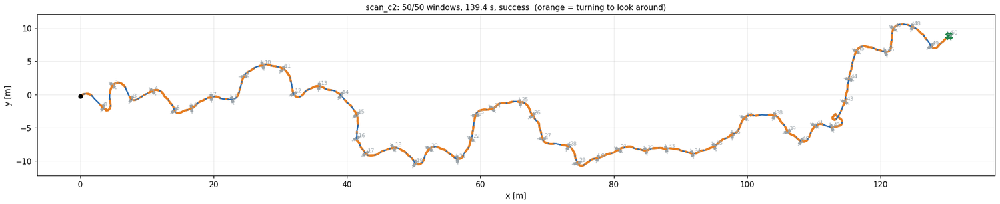

애니메이션 (카메라 화각 표시) · Isaac RTX 렌더: `/data/runs/rl_planner/media/scan_c2_{top,isaac}_long50_seed3.webp`

| | 창문 50 개 L4 | 극한 배치 L5 |
|---|---|---|
| 성공 | 348 (68.0%) | 175 (34.2%) |
| 실패: 순서 위반 / 벽 / 경계 | 49 / 112 / 3 | 65 / 270 / 2 |
| 실패한 구간에서 다음 창문을 보기 전 / 본 뒤 | **111** / 53 | **208** / 129 |
| 창문 50 개 완주 시간 | 약 135 s (구간 중앙값 2.7 s) | 구간 중앙값 2.9 s |
| 통과 직후 0.3 s 안에 다음 창문이 화면에 있음 | 48% | 49% |
| 없을 때: 찾기까지 · 돌아본 각도 · 고도 변화 (중앙값, p90) | 0.7 s (1.9) · 50° (80) · 0.28 m (0.59) | 0.8 s (2.2) · 47° (84) · 0.29 m (0.72) |
| 위아래로 움직여 찾은 비율 (고도 변화 > 0.15 m) | 75% | 74% |
| yaw 변화율 평균 · 40°/s 넘게 도는 시간 | 49°/s · 61% | 49°/s · 61% |
| 그중 찾는 중 / 다음 창문을 본 뒤 | 50 / 49°/s | 50 / 48°/s |

- **둘러보기는 배웠다**: 통과 직후 다음 창문이 안 보이는 구간(절반)에서 좌우로 50° 가량 돌고 위아래로 오르내려 1 초 안에 찾는다.
  찾은 구간의 3/4 은 고도를 0.15 m 넘게 바꿨다 — 좌우뿐 아니라 위아래도 훑는다. 창문당 실패는 0.8% (L4) 로, 같은 배치의 짧은
  코스에서 상태기계 + 둘러보기의 창문당 실패 약 17% 보다 20 배 낮다.
- **실패의 2/3 는 다음 창문을 보기 전에 난다**: 덜 둘러보고 먼저 보인 먼 창문으로 가거나 (순서 위반), 꺾다가 판을 친다.
  '가장 가까운 창문' 규칙은 주변을 다 봐야만 지킬 수 있는데, 정책은 그 비용(시간)과 위험을 스스로 저울질한다.
- **움직임이 적절하지 않다**: 다음 창문을 이미 찾은 뒤에도 49°/s 로 고개를 계속 흔든다 (비행 시간의 61% 를 40°/s 넘게 돈다).
  실제 기체에서는 모션 블러·VIO 에 부담이다. 각속도 벌점을 10 배로 키운 scan_h 는 34°/s · 37% 로 줄었지만 (통과 직후 다음 창문이
  이미 보이는 비율 70%) 창문 50 개 L4 가 검증 세트에서 60.5% 로 낮다.

### 스캔 게이트 — 다 둘러본 뒤에 고르기 (`mission.scan_*`, `configs/train/scan_gate.yaml`)

요청 그대로를 규칙으로 만들었다: 통과 직후(시작 포함) **좌우 ±70° 를 돌아보고 (한 바퀴 회전도 인정) 위아래 ±0.5 m 를 오르내린 뒤에야**
그때까지 본 창문 중 가장 가까운 창문을 고른다. 위아래는 고도 1.0~2.4 m 밖으로는 요구하지 않는다 (창문 중심 0.8~2.6 m 이고, 이
고도에서 2.5 m 앞 창문이 세로 화각 ±25° 에 네 코너까지 든다 — 바닥·천장 3.5 m 근처로 가지 않게). 6 s 안에 다 훑지 못하면 그때까지
본 것으로 고른다. 선택기 안의 규칙이라 학습·평가·온보드가 같다.

범위의 근거 (창문 50 개 코스 64 개 × 49 구간을 만들어 계산): 통과 뒤 0.3~0.8 m 지나서 멈춘 기체가 다음 창문을 네 코너까지 화면에 넣으려면
필요한 둘러보기를 이 범위가 덮는 구간 비율

| 구간 비율 | ±40°, ±0.2 m | ±50°, ±0.3 m | ±60°, ±0.4 m | **±70°, ±0.5 m** | ±80°, ±0.6 m |
|---|---|---|---|---|---|
| 창문 50 개 L4 (0.3 / 0.8 m 지나서) | 75 / 62% | 87 / 75% | 96 / 87% | **99.5 / 96%** | 99.9 / 99% |
| 극한 배치 L5 | 71 / 59% | 82 / 71% | 92 / 82% | **96 / 92%** | 98 / 95% |

- 학습 없이 scan_e 에 게이트만 씌우면 0% — 목표가 없는 동안에도 날아가다 판에 부딪힌다. 미세조정이 필요하다.
- **첫 판정은 잘못 만들었다**: 좌우를 '+70° 와 −70° 둘 다 도달' 로만 쳐서, 한쪽으로 한 바퀴 넘게 돈 정책(scan_i, 200 반복)은 좌우를
  다 보고도 인정받지 못했고, 낮은 창문을 지난 뒤 0.5 m 내려가지 않으려 해 위아래도 못 채웠다 (오르기만 1.3 m) — 게이트가 99~100%
  6 s 제한에서 열렸다. 한 바퀴 회전과 고도 1.0~2.4 m 범위를 넣어 고쳤다 (scan_i2/j2 는 고친 판정으로 이어 학습).
- **정해진 스윕 + 학습 정책 (되돌림)**: 통과 직후 제자리에서 ±75°·±0.5 m 를 기계적으로 훑은 뒤 scan_e 에 넘기면 재학습이 필요 없을
  것 같았지만, 창문 50 개 L4 64 코스 0%: 멈춘 채 다음 창문으로 출발하다 그 판에 부딪히고 (L4 256 코스 69 건), 방금 지난 창문 바로
  뒤에서 오르내리다 그 판에 닿는다 (21 건). 정지 상태에서 출발하는 접근은 정책이 배운 적이 없다.

**게이트 미세조정** (`/data/runs/queue_scan_ij2.sh`, `queue_scan_k.sh`; 검증 시드, 창문 50 개 512 코스, 정책 단독):

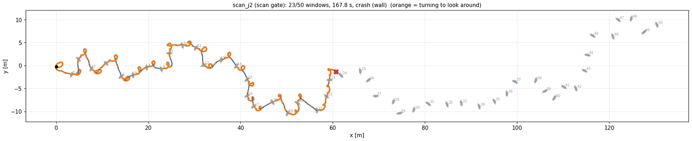

| | scan_c2 (게이트 없음) | scan_j2 7500 | scan_k 7500 |
|---|---|---|---|
| 시작 · 바꾼 것 | — | scan_e 6000 → 게이트 (첫 판정 300 반복, 고친 판정 1200) + `approach_turn` −0.05 | scan_e 6000 + `scan_gate` 관측 (남은 둘러보기) + 고친 게이트 + `approach_turn`, 1500 |
| 완주 · L4 / 극한 | **68.0 / 34.2%** | 22.1 / 12.7% | 30.9 / 22.1% |
| 순서 위반 · L4 / 극한 | 49 / 65 | 11 / 18 | **4 / 9** |
| 벽 충돌 / 구간 · L4 | **0.53%** | 2.5% | 2.0% |
| 경계 이탈 · L4 | 3 | 40 | 43 |
| 구간 시간 중앙값 | **2.7 s** | 6.8 s | 6.6 s |
| 게이트가 다 훑어서 열림 (6 s 제한 아님) | — | 92% (중앙값 4.2 s) | 100% (중앙값 4.3 s) |

(scan_i2 = scan_j2 에서 `approach_turn` 만 뺀 것, 7000 에서 L4 19.9%·극한 10.5% 로 scan_j2 와 같아 멈췄다.)

- **규칙은 제 역할을 한다**: 순서 위반이 49 → 4 건 (scan_k) 으로 줄었다 — 다 둘러본 뒤에 고르니 먼 창문으로 가는 실수가 거의 없다.
  남은 범위를 관측으로 준 scan_k 가 scan_j2 보다 낫고 (L4 22 → 31%), 게이트도 늘 다 훑어서 연다 (6 s 제한 0%).
- **대신 판에 네다섯 배 자주 부딪힌다** (구간당 2.0~2.5% vs 0.53%): 매번 4 s 넘게 판 근처에서 돌고 오르내린다. 정책은 ±70° 왕복
  (210°) 대신 한쪽으로 한 바퀴(360°) 돌기를 배웠고 (위로 1 m 올랐다가 아래로 0.5 m 까지 내려가는 4 s 동안 시간이 남아서), 경기장
  경계(좌우 ±12 m)를 관측하지 못해 스캔 중 옆 벽으로 밀려난다 (scan_i2 7000 의 경계 이탈 52 건이 모두 |y| = 12 m).
- 1500 반복으로는 게이트 없는 정책의 정밀함을 되찾지 못했다. 다음에 할 것: 위아래 범위를 필요한 만큼으로 (구간의 81~88% 는 고도
  변화가 필요 없다), 스캔 중 제자리 유지 보상, 경계까지 거리 관측, 그리고 더 긴 학습.

### 배포 권장 (둘러보기 모드)

- **창문이 엉뚱하게 놓이는 코스: scan_c2 + 안전 필터** (`window_mission/*_scan_c2/export_6000`, `safety.scan_hold: true`).
  → §13 에서 실제 기체(FX450) 판정으로 이어 학습한 **scan_fx (`*_scan_fx/export_6900`)** 로 갱신 (같은 관측·행동).
  일자 코스(색 순서)는 §11 권장 그대로 (빠르게 speed_a, 강건하게 범용 MLP).
- 온보드: `OnboardPlanner` 가 heading 설정점 `out["yaw"]` 를 낸다 — 제어기에 yaw 입력이 필요하다 (§8 결정 7). 통과는 `mark_passed()`
  로 알려 주거나 플래너가 센다 (추정한 창문 면을 개구부 안 ±0.2 m 로 지날 때; 판이 유한해 옆으로 지나면 통과가 아니다 — 이번에 고침,
  `tests/test_onboard.py`).
- 검증하지 않은 것: 90°/s 회전에서의 실제 모션 블러·VIO, 창문 추적기, 실제 대회 규칙 (가장 가까운 창문인지 색 순서인지).

### 재현

```bash
# 평가 (검증 시드로 고르기 → 평가 시드 26 조건 → 일자 코스 42 조건 → Isaac PhysX)
bash /data/runs/scan_eval.sh val scan_c2=<run>/export_6000 scan_e=<run>/export_6000 scan_h
SHARDS=4 bash /data/runs/scan_eval.sh final scan_c2=<run>/export_6000
SHARDS=4 bash /data/runs/scan_eval.sh line scan_c2=<run>/export_6000
N50=128 bash /data/runs/isaac_check_scan.sh scan_c2=<run>/export_6000
# 둘러보기 통계 / 위에서 본 그림·애니메이션 / Isaac RTX 렌더
$PY rl_planner/scripts/scan_stats.py --policy <export> --config rl_planner/configs/scan/long50.yaml --level 4 --num-scenes 512
$PY rl_planner/scripts/plot_course.py --policy <export> --config rl_planner/configs/scan/long50.yaml --seed 3 --png c.png --gif c.gif
$PY rl_planner/scripts/play_isaac.py --policy <export> --config rl_planner/configs/scan/course.yaml \
    --config rl_planner/configs/scan/long50.yaml --level 4 --seed 3 --every 2 --max-seconds 30 --safe --set safety.scan_hold=true
```

## 13. 공 대신 실제 기체 — FX450 (10/28 저녁)

> 요청: "이제 공 대신에 진짜 드론을 넣으면 안되냐", "이거 실제 FX450 fetch 해와서 스펙 대조하면서 살펴봐봐".

**결론**: 판정·렌더의 드론을 지름 0.6 m 공에서 실제 FX450 모양(휠베이스 450 mm X, 10 인치 프롭 4, 몸체, 짐 상자)으로 바꿨다
(`drone.shape: airframe`, `configs/drone/fx450.yaml`). 일자 코스 정책은 그대로다 (41 조건 평균 gen_mlp 98.9 → 98.9%, speed_a
97.1 → 97.2%). 고개를 돌리며 지나는 둘러보기 정책은 창문 50 개 코스에서 크게 떨어졌다 (scan_c2 69.9 → 52.0%): 대각선 0.70 m 의 실제
기체가 비스듬히 지날 때 프레임에 걸린다. 실제 기체 판정으로 이어 학습한 **scan_fx** (scan_c2 에서 1200 반복, 검증 시드로 6900
선택) + 필터가 이를 되찾고 넘어선다: 창문 50 개 L4 **77.7%** (창문당 99.5%; 공 판정 scan_c2 69.9%), 둘러보기 25 조건 평균 **55.3%**
(공 판정 50.7%, 실제 기체 판정 scan_c2 37.8%). Isaac PhysX 에서도 결과가 같다.

### 스펙 대조 — 공식 자료와 팀 모델

'FX450' 은 공개된 제품명으로 찾을 수 없다 (같은 이름은 노르웨이 Robot Aviation 의 180 kg 고정익뿐). 팀 문서가 "FX450 휠베이스
450 mm X-쿼드" 라 하므로 같은 급의 원형인 DJI Flame Wheel F450 공식 스펙과, 같은 급 DJI 공식 추진계 E310 스펙을 받아 대조했다
(dji.com, 10/28 열람).

| 항목 | DJI 공식 | 팀 (성진 문서·CAD·SDF) | 이 시뮬 (이전) | 판정 |
|---|---|---|---|---|
| 휠베이스 | F450 450 mm | 450 mm (`DYNAMICS.md` §9.2, C++ `r_arm = 0.225/√2`) | 공 지름 0.60 m | 일치. 단 Gazebo 생성기 `gen_worlds.py` 는 모터 x=y=0.1125 m (√2 두 번) → 휠베이스 318 mm, 이웃 프롭 겹침 |
| 프롭 | 10×3.8 인치 (또는 8×4.5) | 10 인치 (D 0.254, `qc_motor.hpp`) | — | 일치 |
| 프레임 무게 | 282 g | 299 g (판 2 + 암 4, CAD) | — | +6% |
| 이륙 중량 | 0.8~1.6 kg | 1.27 kg (짐 없이) / 2.27 kg (짐 1 kg) | 2.27 kg | 짐 포함 시 공식 상한의 1.42 배 |
| 배터리 | 3~4S | 22.2 V = 6S ("개략") | — | 다름 (미확정) |
| 최대 추력 | E310 800 g/로터 @12 V (3S) → 추력/무게 1.41 (2.27 kg) | 모터 모델: 토크 상한 0.2 N·m 에서 평형 634 rad/s = 호버 → 추력/무게 1.0 | 2.0 | 셋 다 다름 |
| 관성 | — | 1.711e-2, 1.716e-2, 2.124e-2 (CAD) | 같음 | 일치 |

추력은 실제로는 문제가 아니었다: 제어기가 가속을 수평 2 m/s², 수직 3 m/s² 로 자르므로 최대로 쓰는 추력이 무게의 1.32 배다.
추력/무게를 1.41 로 낮춰도 (`configs/drone/fx450_e310.yaml`) 9 조건 중 8 개가 소수점까지 같다. 과중량(질량 ×1.1~1.2, 추력 ×0.85~0.9)
에서만 추력/무게가 1.07 로 떨어져 51.6 → 19.7% — 짐을 더 실으면 E310 급 추진계로는 모자란다.

### 무엇을 넣었나 — `core/airframe.py`

- **모양** (`default.yaml drone.airframe`): 프롭 원판 4 (반경 0.127 m, 두께 6 mm, 중심 반경 0.225 m, 45° X, 섀시 위 2 cm), 몸체 상자
  0.20×0.20×0.06 m, 짐 상자 0.14 m (섀시 아래 8.2 cm), 무게중심은 섀시 원점 3.2 cm 아래 (성진 SDF). 렌더용으로 암(앞 둘 빨강)·모터·카메라.
- **판정**: 창문면마다 각 부품이 면과 만나는 단면 — 프롭은 원판이 잘리는 현(정확), 상자는 투영(보수적) — 이 개구부를 벗어나고 벽판
  위면 충돌. 통과 여유는 기체 그림자(창문면 투영)로 잰다. 기체 근처 3 개 벽판만 계산 (4096 env × 창문 20 개에서 30 → 2.6 ms/서브스텝,
  모든 창문을 계산할 때와 결과 동일: 128 코스 50 창문 비행 결과가 같다).
- **Isaac**: 강체에 시각 부품을 단 기체 (`AirframeCfg` 스포너), `play_isaac.py` 는 자세까지 그린다. 위에서 본 애니메이션도 실제 크기 기체.
- **로터 번호**: 인덱스 i = 성진 Prop(i+1) (실측 믹서표 순서: 1 뒤오른쪽 CCW, 2 뒤왼쪽 CW, 3 앞오른쪽 CW, 4 앞왼쪽 CCW) — 팀이 기다리던
  결정을 `interface/README.md` 에 적었다.

### 결과 — 같은 장면 (평가 시드 12345, 조건마다 512 코스)

| 정책 + 필터 | 판정 | 일자 41 조건 평균 | 명목 L5 | yaw55 | 둘러보기 꺾인 L4 | 창문 50 개 L4 | 50 개 극한 | 둘러보기 25 조건 평균 |
|---|---|---|---|---|---|---|---|---|
| gen_mlp | 공 | 98.9 | 100 | 97.5 | | | | |
| gen_mlp | FX450 | 98.9 | 100 | 91.2 | | | | |
| speed_a | 공 | 97.1 | 99.8 | 92.8 | | | | |
| speed_a | FX450 | 97.2 | 99.8 | 91.8 | | | | |
| scan_c2 | 공 | | | | 93.8 | 69.9 | 36.5 | 50.7 |
| scan_c2 | FX450 | | | | 91.8 | 52.0 | 24.4 | 37.8 |
| **scan_fx (6900)** | FX450 | | | | 94.3 | **77.7** | 41.4 | **55.3** |

- 일자 코스: 진행 방향으로 지나면 FX450 의 가로 반폭(프롭 끝 0.286 m)이 공(0.30)보다 좁고 세로는 훨씬 얇아 같거나 낫다. 비스듬한
  창문(yaw55: 55° 기운 창문을 기수 고정으로 지남)만 대각선 반폭(0.352 m)이 걸려 −6 %p.
- 둘러보기: 꺾인 코스 1~8 개는 거의 그대로 (−2~3 %p), 창문 50 개에서 창문당 실패율이 0.7 → 1.3% 로 늘어 완주가 18 %p 줄었다.
  늘어난 실패는 거의 다 벽 충돌. 바람·좁은 창문·관측 잡음 조건에서 특히 크다 (돌풍 49 → 18%, 좁은 창문 53 → 12%).
- Isaac PhysX (꺾인 코스 L4, 128 코스, FX450 판정): scan_c2 Isaac 89.1% / torch 89.1%.

### 실제 기체로 이어 학습 — scan_fx

scan_c2 (model_6000) 에서 판정만 실제 기체로 바꿔 (`configs/drone/fx450.yaml`, 나머지 scan_c2 와 같음) 1200 반복 이어 학습했다
(`/data/runs/queue_scan_fx.sh`, torch 4096 env, 2 h). 고르기는 §12 와 같은 검증 세트 (시드 4242, 8 조건 × 같은 장면 512 개, FX450 판정,
`/data/runs/fx450_eval.sh val`):

| 성공 % (필터 포함) | 꺾인 L4 / L5 | 50 개 L4 / L5 | 극한 | 복합 중간 | 끊김 1~4 s | 강풍 | 8 조건 평균 |
|---|---|---|---|---|---|---|---|
| scan_c2 (6000) | 91.6 / 85.9 | 48.8 / 35.2 | 23.4 | 5.5 | 49.0 | 2.3 | 42.7 |
| scan_fx 6300 | 94.7 / 87.5 | 68.8 / 51.0 | 37.3 | 20.9 | 68.6 | 15.8 | 55.6 |
| scan_fx 6600 | 94.3 / 90.8 | 74.8 / 53.3 | 37.5 | 22.9 | 70.7 | 17.8 | 57.8 |
| **scan_fx 6900** | 94.5 / 91.6 | 76.2 / 58.6 | 42.6 | 23.6 | 73.2 | 20.3 | **60.1** |
| scan_fx 마지막 (7199) | 95.5 / 88.3 | 77.5 / 59.4 | 41.4 | 24.2 | 77.0 | 16.0 | 59.9 |

6900 을 고른다 (마지막과 0.2 %p 차로 사실상 같다). 평가 시드 26 조건 (`/data/runs/fx450_eval.sh scan`, 같은 장면 512 코스):

| 성공 % (필터 포함) | 공 판정 · scan_c2 | FX450 판정 · scan_c2 | FX450 판정 · **scan_fx** | 창문당 실패 (scan_fx) |
|---|---|---|---|---|
| 꺾인 코스 L3 / L4 / L5 | 96.5 / 93.8 / 88.1 | 95.9 / 91.8 / 85.2 | 98.0 / 94.3 / 90.4 | |
| **창문 50 개 L4** | 69.9 | 52.0 | **77.7** | 0.50% |
| 창문 50 개 L5 (거친 검출) | 54.1 | 41.8 | 56.1 | 1.15% |
| **창문 50 개 극한 배치** | 36.5 | 24.4 | **41.4** | 1.75% |
| 50 개 · 카메라 끊김 1~4 s / 4~10 s | 68.4 / 63.9 | 52.5 / 48.6 | 70.9 / 72.5 | 0.69% (1~4 s) |
| 50 개 · 프레임 누락 30% / 50% | 67.6 / 58.8 | 55.9 / 48.0 | 75.0 / 66.6 | |
| 50 개 · 검출 지연 0.1~0.2 s / 0.3~0.5 s | 70.5 / 63.9 | 59.6 / 54.9 | 78.3 / 71.7 | |
| 50 개 · 카메라 5 Hz / 과중량 / VIO 드리프트 | 71.3 / 69.9 / 56.6 | 57.2 / 51.6 / 30.9 | 76.8 / 76.2 / 63.1 | |
| 50 개 · 좁은 창문 0.85~0.95 m / 모션 블러 20 ms | 52.5 / 37.9 | 11.9 / 24.6 | 53.5 / 43.6 | |
| 50 개 · 돌풍 / 강풍 / 매우 강한 바람 | 49.0 / 12.5 / 0.2 | 17.6 / 1.2 / 0.0 | 54.3 / 19.3 / 1.2 | 3.23% (강풍) |
| 50 개 · 카메라 장착 오차 2° / 4° | 32.8 / 0.6 | 22.5 / 2.3 | 36.9 / 2.9 | |
| 50 개 · 자기 상태 관측 잡음 ×3 | 32.8 | 8.0 | 34.6 | |
| 50 개 · 복합 중간 / 거침 | 20.5 / 0.0 | 6.6 / 0.0 | 27.3 / 0.0 | 2.56% (중간) |
| **25 조건 평균** | 50.7 | 37.8 | **55.3** | |
| 검출 전무 — 충돌 % | 0.0 | 0.0 | 0.0 | |

- **25 조건 모두 실제 기체 판정 scan_c2 보다, 그리고 공 판정 scan_c2 보다도 같거나 높다** (복합 거침은 셋 다 0%, 장착 오차 4° 는
  셋 다 3% 이하).
  같은 장면 짝 비교 (FX450 판정, scan_fx 만 성공 : scan_c2 만 성공): 50 개 L4 183 : 51 (p = 1e-18), 극한 128 : 41, 돌풍 218 : 30,
  좁은 창문 237 : 24. 꺾인 코스 L4 26 : 13 (p = 0.05).
- 통과 여유(기체 그림자 기준)가 0.150 → 0.168 m 로 늘었고, 창문 50 개 완주 시간은 135.5 → 138.5 s (+2%).
- 왜 공보다도 나은가: 실제 기체는 세로로 얇아 (프롭 위 끝 ~0.09 m, 공 0.30 m) 위아래 여유가 크다. 실제 모양으로 학습하면 그 여유를
  쓰고 대각선 폭에 맞춘다. 반복 수 때문만은 아니다 — 같은 scan_c2 에서 공 판정으로 900~1500 반복 더 학습한 scan_e·h 는 나아지지
  않았다 (§12).
- Isaac PhysX (꺾인 코스 L4, 128 코스, FX450 판정): scan_fx Isaac 93.8% / torch 92.2% (`/data/runs/rl_planner/isaac_check_fx6900`).
- **둘러보기 배포 후보를 scan_fx (export_6900) 로 바꾼다** — 실제 기체 판정에서 모든 조건이 같거나 낫다. 관측·행동은 scan_c2 와 같아
  온보드 코드는 그대로다. 추력/무게 1.41 (E310) 확인은 scan_c2 로만 했다 (과중량 외 같음).

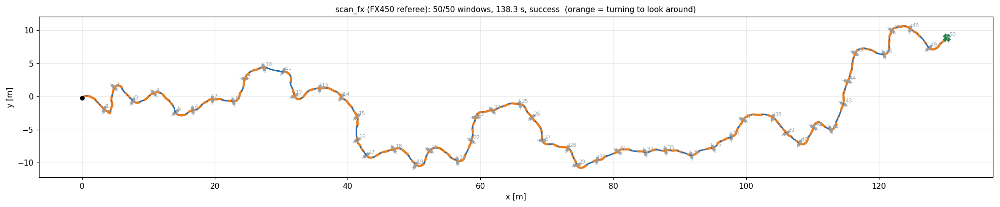

Isaac RTX 렌더 (추적 카메라 + 위에서 본 화면, 처음 30 s): `/data/runs/rl_planner/media/scan_fx_isaac_long50_seed3.webp`

## 14. 줄에 매단 짐 + convex layer (10/28 밤)

> 요청: "줄이랑 로드를 매달고 창문을 통과할거야. 그 안에 동역학 공식을 넣어서 제약 최적화를 하는 방식을 취할거야. 지금 신경망을
> 유지한채로 여기에 convex layer를 추가하거나 아니면 다른 제약 최적화를 넣어서 하면됨. 동역학은 지금 진자같은 형태잖아".

**지금까지의 짐은 진자가 아니었다**: 짐 1 kg 은 기체에 용접된 강체다 (이 시뮬: 질량·관성에만 포함, 성진 Simscape: Weld Joint —
`DYNAMICS.md` §9.3 "케이블 현수가 아니다"). 1.8 Hz 로 흔들리는 것은 짐 때문에 무게중심이 추력면 8.1 cm 아래로 내려간 기체 전체의 모드다.
그래서 줄에 매단 짐의 진자 동역학을 새로 넣었다.

**결론**: 기체 아래 0.4 m 줄에 짐 1 kg 을 매달고 (진자, `core/slung.py`), 신경망 뒤에 진자 동역학으로 1 s 앞을 예측하는 convex
layer (모든 환경을 한 번에 푸는 MPC QP, `planners/convex_layer.py`)를 붙였다. 일자 코스 41 조건 (FX450 판정, 같은 장면 512 코스,
필터 포함): **신경망만 0.5%** (짐이 첫 창문 아래 바에 걸림) → 재학습 없이 **+ layer 79.0%** → layer 를 환경 안에 두고 줄 센서
관측을 더해 800 반복 이어 학습한 **slung_a + layer 95.6%** (명목 L4 100%, L5 98.6%; 짐 없는 범용 정책은 98.9%). 41 조건 모두
재학습 전보다 높고, 창문 추정이 치우치는 조건에서 차이가 가장 크다 (카메라 장착 오차 2° 54 → 98%, VIO 드리프트 35 → 99%).
이어 학습한 신경망은 layer 없이도 72% 를 지나지만 (검증 8 조건), 둘을 함께 쓸 때 가장 낫다. Isaac PhysX 에서 같은 결과
(L4 128 코스 100 / 100%), 온보드 코드도 같은 layer 를 쓴다. 남은 약점은 카메라 장착 오차 4° (76%), 긴 카메라 끊김 (80~83%),
복합 거침 (49%).

### 모델 — `core/slung.py`, `configs/slung/base.yaml`

- 기체 (짐 없는 FX450, 1.27 kg, 관성은 성진 0 kg 값) 아래 갈고리(무게중심 5 cm 아래)에 0.4 m 줄로 짐 1 kg (판정 구 반경 0.12 m).
  줄은 당기기만 하는 스프링·감쇠 (k 5000 N/m: 1 kg 에 2 mm 늘어남, c 30 N·s/m), 느슨해질 수 있다. 짐은 질점 (중력·항력·바람).
- 코어가 매 물리 스텝 줄 장력을 계산해 기체에 힘(갈고리에서, 무게중심 기준 토크 포함)으로 주고 짐을 적분한다 — torch 와 Isaac 이
  같은 진자를 난다 (L4 128 코스, Isaac / torch: gen_mlp + layer 87.5 / 85.9%, slung_a + layer 100 / 100%).
- 판정: 짐(구)과 줄(갈고리 → 짐 선분)도 모든 개구부 안으로 지나야 한다 (`CRASH_LOAD`, `CRASH_CABLE`). 완주는 짐이 마지막 창문을
  지나야 인정.
- 시험 (`tests/test_slung.py`): 정지 매달림, 진자 주기 (2π√(L/g) 의 2% 안), 느슨함, 운동량 보존, 갈고리 토크.

### convex layer — `planners/convex_layer.py`, `core/qp.py`

신경망은 그대로 두고 그 행동을 QP 로 투영한다.

- **예측 모델** (동역학 공식): 웨이포인트 제어기 폐루프 (v_cmd = kp (w − p), a_cmd = kv (v_cmd − v), 제어기는 총질량으로 추력 계산)
  + 선형화한 줄 진자 (팽팽, 작은 각): m_Q ẍ_Q = m a_cmd + m_L g/L (x_L − x_Q), ẍ_L = −g/L (x_L − x_Q), 수직은 짐이 L 아래.
  결정 주기 0.1 s 로 정확 이산화 (영차 유지), 1 s 앞까지.
- **변수**: 이번 행동 3 개 + 이후 웨이포인트 3 블록 (receding horizon: 첫 행동만 비행).
- **제약**: 짐 흔들림 25° 안 / 창문면 0.35 m 안에서 드론(반폭 0.32×0.10 m)과 짐이 개구부 안 (여유 0.05 m), 방금 지난 창문도 짐이 지날
  때까지 / 행동 상자. 창문은 드론이 가진 추정을 쓴다 (판정의 참값이 아님).
- **목적**: 신경망 행동에 가장 가깝게 + 창문 근처에서 기체·줄·짐을 개구부 가운데로 (무게 5).
- **풀이**: 모든 환경을 한 번에 — OSQP 의 ADMM 을 배치로 (Cholesky 한 번 + 반복 40, 이전 결정에서 웜스타트). osqp 패키지와 1e-5 안으로
  일치, 펼친 반복을 통해 미분 가능 (`tests/test_qp.py`). 4096 환경 GPU 에서 수십 ms.
- **드론에 있는 정보만**: 자기 자세·속도, 줄 센서 (갈고리 기준 짐 위치·속도), 창문 추정 — 학습 env 안 (`slung.convex_layer.in_env`),
  평가 (`+layer`), 온보드에 같은 코드.
- 예측 정확도 (고정 행동 1 s): 보통 행동에서 드론 2~6 cm, 짐 4~8 cm 오차; 전속 가속 (제어기 가속 상한 2 m/s² 에 걸림)에서는 16~30 cm.

### 결과 — 일자 코스 42 조건, 같은 장면 (평가 시드 12345, 512 코스), 필터 포함

| 성공 % | 신경망만 (gen_mlp) | gen_mlp + layer, 공 판정 | gen_mlp + layer | gen_mlp + layer, 가운데 5 | **slung_a + layer** |
|---|---|---|---|---|---|
| 명목 (3) | 0.0 | 78.6 | 85.6 | 86.3 | **99.2** |
| 학습 DR 안 (12) | 0.1 | 66.4 | 78.1 | 80.5 | **95.8** |
| DR 밖 (10) | 1.7 | 61.7 | 78.1 | 79.6 | **93.5** |
| 처음 보는 교란 (14) | 0.0 | 74.0 | 78.4 | 81.6 | **99.4** |
| 복합 (2) | 1.4 | 18.2 | 36.0 | 37.3 | **74.1** |
| **41 조건 평균** | 0.5 | 66.4 | 76.7 | 79.0 | **95.6** |
| 검출 전무 — 충돌 % | 0.0 | 0.0 | 0.0 | 0.0 | 0.0 |

판정은 '공 판정' 열 말고 모두 FX450. '가운데 5' = 창문 근처에서 기체+줄+짐을 개구부 가운데로 당기는 목적 항 (`center_weight` 5,
지금 기본값; slung_a 도 이 설정으로 학습·평가). 조건별 전체 표: [`docs/tables_slung.md`](docs/tables_slung.md)
(`/data/runs/rl_planner/bench_slung_a`, `bench_slung_line_af`, `bench_slung_line`).

- **신경망만으로는 짐이 창문 아래 바에 걸린다** (드론이 창문 가운데로 날면 짐은 0.45 m 아래).
- 공 판정이면 기체+줄+짐이 개구부 높이에 안 들어가 좁은 창문 3% — 실제 기체(납작한 FX450)로 판정해야 82%.
- **재학습 없는 gen_mlp + layer** 의 남은 실패는 짐이 아래 바에 앞에서 닿는 경우 (흔들림 2~10°, 1.1 m/s): 0.35 m 앞에서야 제약이
  걸려 겨우 올리는데 예측 오차로 늦다. 게이트 구간을 0.7 m 로 넓히면 오히려 나빠진다 (L5 84 → 73%). 창문 추정이 치우치는
  조건에서 약하다 (장착 오차 2° 54%, VIO 드리프트 35%, 끊김 3 s 58%) — 여유 5 cm 를 추정 오차가 먹는다.
- **slung_a + layer** 는 41 조건 모두 그보다 높다: 명목 L4 100%, L5 98.6% (팀 운용 한계 99.0%), 짐 충돌 0~0.6%; 장착 오차 2°
  54.1 → 97.5%, VIO 드리프트 35.4 → 99.0%, VIO 자세 잡음 57.6 → 98.0%, 느린 모터 67.6 → 99.8%, 복합 중간 54.5 → 98.8%.
  시간은 명목 L4 11.1 s. 남은 약점: 카메라 장착 오차 4° 75.6% (짐 충돌 18.8%), 카메라 끊김 3 / 7 / 10 s 83 / 80 / 83%,
  넓은 배치·강한 돌풍 91%, 복합 거침 49%.
- Isaac PhysX (L4, 128 코스): slung_a + layer Isaac 100% / torch 100% (`isaac_check_slung_a`; gen_mlp + layer 87.5 / 85.9%).

### 같은 장면, 옆에서 본 비행 (`scripts/plot_slung.py`, L4 seed 5)

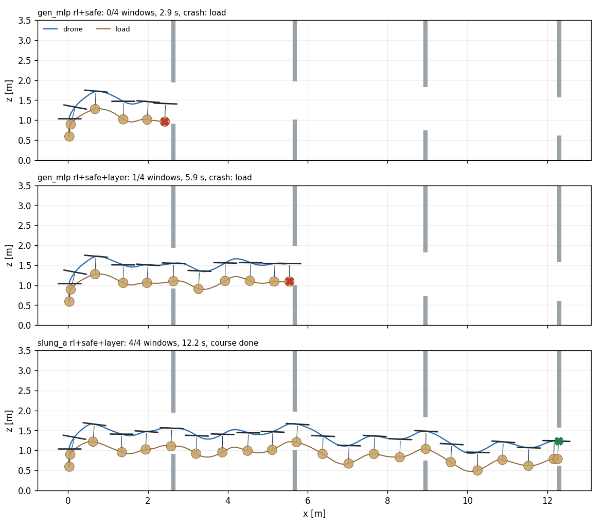

신경망만: 드론이 창문 가운데로 날아 짐이 첫 창문 아래 바에 걸린다 (2.9 s). gen_mlp + layer: 첫 창문은 지나지만 둘째 창문 아래 바
(1.0 m)에 짐(1.1 m, 반경 0.12)이 닿는다 — layer 는 창문면 0.35 m 앞에서야 개구부 제약을 걸어 올리기에 늦다. slung_a + layer: 창문
앞에서 미리 높이를 올려 짐이 바 위로 지난다 (4/4, 12.2 s).

Isaac RTX 렌더 (slung_a + layer, L4 seed 5, 3/3 9.1 s, 머리줄에 흔들림 각): `/data/runs/rl_planner/media/slung_a_isaac_L4_seed5.webp`

### 이어 학습 — slung_a (layer 를 환경 안에 두고)

gen_mlp (model_3997) 의 관측에 줄 센서 6 개 (갈고리 기준 짐 위치 / 줄 길이, 짐 상대 속도; heading 좌표, `observation.slung`)를 가중치
0 으로 붙이고 (`scripts/expand_obs.py --add slung`), convex layer 를 환경 안에 둔 채 (`slung.convex_layer.in_env: true`: 환경이 매
행동을 투영해서 비행) 800 반복 이어 학습했다 (`configs/slung/train.yaml`, 범용 학습 DR, 흔들림 벌점 −0.5 (짐 수평 변위 / 줄 길이)²,
torch 4096 env, 1.5 h, `/data/runs/queue_slung_a.sh`).

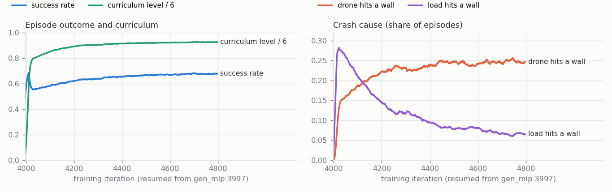

학습 중 짐 충돌이 25.6 → 6.7% 로 줄었다 (같은 동안 커리큘럼이 L4.3 → L5.6 으로 올라 벽 충돌은 12 → 25%; 학습 DR 은 평가보다
거칠다). 줄 충돌은 0%. layer 가 바꾼 행동은 결정의 60% (가운데 맞추기 포함).

고르기 — 검증 시드 4242, 줄 짐 8 조건 × 같은 장면 512 개 (`/data/runs/after_slung_a.sh`):

| 성공 % (필터 포함) | slung_a 4400 + layer | 4600 + layer | **마지막 + layer** | 마지막 단독 | gen_mlp + layer |
|---|---|---|---|---|---|
| 명목 L4 / L5 | 99.6 / 98.4 | 99.4 / 99.2 | 100.0 / 99.4 | 90.0 / 85.2 | 92.2 / 85.9 |
| 좁은 창문 / 넓은 배치 | 99.2 / 91.2 | 98.6 / 92.8 | 99.4 / 92.4 | 15.2 / 77.9 | 87.5 / 78.3 |
| 카메라 장착 오차 2° / 끊김 3 s | 91.2 / 77.5 | 95.5 / 81.2 | 97.1 / 83.0 | 77.1 / 73.6 | 52.5 / 57.2 |
| VIO 드리프트 / 돌풍 | 94.1 / 99.8 | 96.3 / 100.0 | 97.1 / 100.0 | 68.4 / 87.3 | 35.2 / 93.9 |
| **8 조건 평균** | 93.9 | 95.4 | **96.0** | 71.9 | 72.9 |

마지막 (model_4796, `export`) 을 고른다. **layer 없이 신경망만으로도 72%** — gen_mlp 단독 0% 에서, 짐을 매단 채 창문을 지나는 법을
신경망이 스스로 배웠다 (좁은 창문만 15%: 여유가 거의 없는 곳은 layer 가 필요). 학습한 신경망 + layer 가 둘 중 어느 것보다 낫다.

### 온보드 — `planners/onboard.py`

`OnboardPlanner(export, n_windows, slung=<리그의 slung 절>)` (slung_a 처럼 줄 짐으로 학습한 정책이면 `slung` 생략). 줄 센서는
`drone_state["load"] = {"offset": [x, y, z], "vel": [vx, vy, vz]}` — 갈고리에서 짐까지의 위치와 짐 속도 − 기체 속도, 둘 다 기체 축
(2 축 줄 각도 센서라면 offset = L dir_b, vel = d(offset)/dt + ang_vel × (attach + offset)). 같은 `SlungLayerFilter` 가 안전 필터 뒤에서
마지막으로 투영하고, `done` 은 짐이 마지막 창문을 지나야 참이다. 출력에 `pre_layer_action`, `layer_changed` 가 더 있다.
학습 환경과 대조 (`tests/test_onboard.py::test_onboard_slung_layer_matches_env`, 닫힌 고리 torch): 관측 정확히 같음 (slung_a 의
줄 센서 항 포함), 투영 행동 차이 2e-7 (slung_a, layer 가 92 결정 중 39 번 바꿈), 3e-7 (gen_mlp + base.yaml), 4e-7 (scan_c2, 194 중 102).

### 배포 권장 (줄에 매단 짐)

- **slung_a + 안전 필터 + convex layer** (`window_mission/*_slung_a/export`; 정책 설정에 줄 짐과 layer 가 들어 있다). 온보드는
  `OnboardPlanner(export, n_windows)` 에 줄 센서 (`drone_state["load"]`)를 더 준다. 실제 리그가 다르면 (줄 길이·짐 무게·갈고리 위치)
  `slung=` 로 넘긴다 — layer 의 예측 모델이 이 값을 쓴다.
- 검증하지 않은 것: 실제 줄 센서 (각도 센서 / 아래 보는 카메라)의 잡음·지연, 줄이 느슨해지는 큰 기동, 짐의 회전·흔들림 감쇠 차이,
  탄성 줄. 지금 판정의 짐은 구 (반경 0.12 m).

### 고친 것 (이번에)

- 갈고리 오프셋: layer 가 짐을 무게중심 아래 줄 길이로 봤다 (실제는 갈고리 5 cm + 줄) → L4 1.6 → 91% (128 코스).
- 질량 DR: 기본 DR 의 질량 ×0.56~1.0 (짐 0~1 kg 용) 이 줄 짐에서는 기체를 0.28 kg 로 만들어 명시 결합이 발산 (속도 26 m/s) →
  줄 짐 프리셋은 총질량 ±5%.

### 재현

```bash
# §13 실제 기체 — 이어 학습, 고르기 (검증 시드 8 조건), 평가 (26 조건), Isaac 확인
bash /data/runs/queue_scan_fx.sh
bash /data/runs/fx450_eval.sh val fx6900=<scan_fx run>/export_6900 [이름=export ...]
bash /data/runs/fx450_eval.sh scan fx6900=<scan_fx run>/export_6900
$PY rl_planner/scripts/evaluate.py --backend isaac --device cuda:0 --planners rl+safe --policy <export> --level 4 --num-scenes 128 \
    --seed 12345 --record 0 --config rl_planner/configs/scan/course.yaml --set safety.scan_hold=true --set drone.shape=airframe --out <dir>
# §14 줄 짐 — 이어 학습, 그 뒤 export·고르기·42 조건·Isaac 확인 (after_slung_a.sh)
bash /data/runs/queue_slung_a.sh; bash /data/runs/after_slung_a.sh
$PY rl_planner/scripts/plot_slung.py --policy gen_mlp=<export> --policy slung_a=<export> --planner gen_mlp:rl+safe \
    --planner gen_mlp:rl+safe+layer --planner slung_a:rl+safe+layer --level 4 --seed 5 --png side.png
$PY rl_planner/scripts/play_isaac.py --policy <slung_a export> --config rl_planner/configs/slung/base.yaml --level 4 --seed 5 --safe --layer
RL_PLANNER_SLUNG_EXPORT=<slung_a export> $PY -m pytest rl_planner/tests/test_onboard.py -k slung
```
